<div align="center">


# GithubStarsManager

**Turn thousands of GitHub stars into an AI-organized, searchable knowledge base.**

AI Summaries & Categories · Vector Semantic Search · Commit-Pinned Repo Q&A · Smart Release Tracking · MCP Agent Server · Desktop Plugins

<p>
  <b>English</b> &nbsp;|&nbsp; <a href="README_zh.md">简体中文</a>
</p>

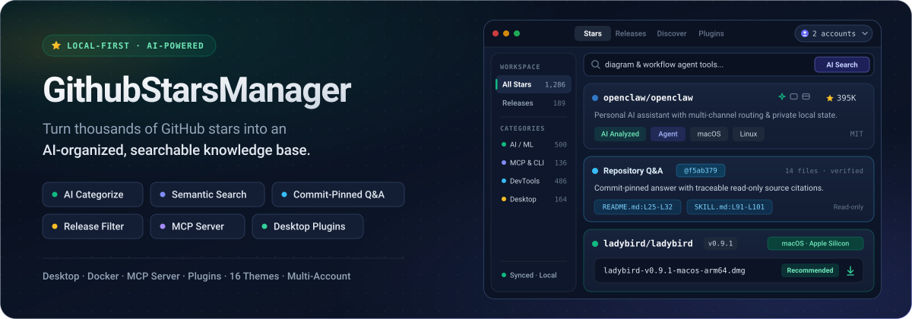

<p>
  <a href="https://github.com/AmintaCCCP/GithubStarsManager/releases"><b>⬇️ Download Desktop</b></a>
  &nbsp;·&nbsp;
  <a href="#docker-self-host"><b>🐳 Docker Self-Host</b></a>
  &nbsp;·&nbsp;
  <a href="#quick-start"><b>⚡ Quick Start</b></a>
  &nbsp;·&nbsp;
  <a href="#integrations"><b>🧠 Vector Search &amp; MCP</b></a>
  &nbsp;·&nbsp;
  <a href="https://github.com/AmintaCCCP/GithubStarsManager/wiki/Plugin-Usage-EN"><b>🔌 Plugin Docs</b></a>
</p>

<p>
  
  
  
  
  <a href="https://zread.ai/AmintaCCCP/GithubStarsManager"></a>
  <a href="https://linux.do"></a>
</p>

<p>
  <a href="https://www.producthunt.com/products/githubstarsmanager?embed=true&utm_source=badge-featured&utm_medium=badge&utm_source=badge-githubstarsmanager" target="_blank" rel="noopener noreferrer"></a>
  &nbsp;
  <a href="https://trendshift.io/repositories/28489?utm_source=trendshift-badge&amp;utm_medium=badge&amp;utm_campaign=badge-trendshift-28489" target="_blank" rel="noopener noreferrer"></a>
</p>

</div>

---

## Demo Video

See GithubStarsManager in action — syncing stars, running AI organization, searching semantically, tracking releases, and asking repository questions:

https://github.com/user-attachments/assets/ad3493a0-948a-4de5-8de1-4e9afc46ec4d

---

## Core Workflows

Stop starring projects and losing them. Everything from AI organization and semantic discovery to commit-pinned answers and OS-matched downloads lives in one fast desktop or self-hosted workspace.

<p align="center">
  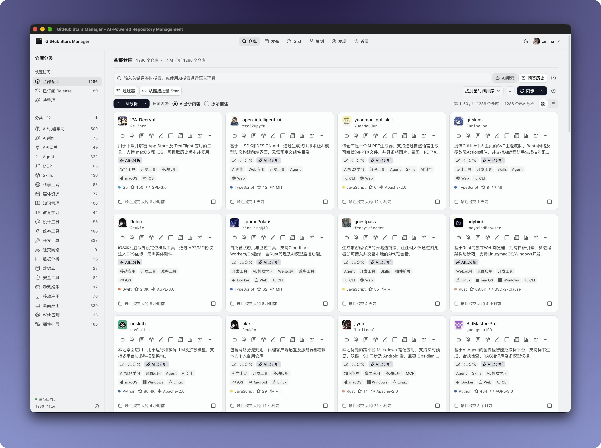
  <br />
  <sub><i>Main Stars workspace — smart category sidebar, platform badges, multi-account switching, and draggable card quick actions. Screenshots show the Simplified Chinese UI; the app ships natively in <a href="#interface-languages">10 languages</a>.</i></sub>
</p>

<table>
  <tr>
    <td width="50%" valign="top">
      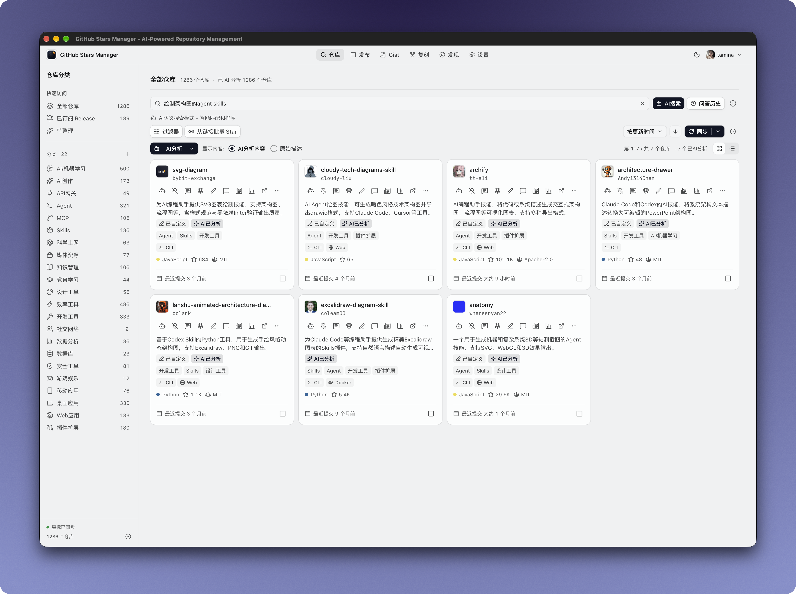
      <br />
      <strong>Search by intent, not memory</strong> — Natural-language semantic search surfaces the right repos even when your query shares zero keywords with their names.
    </td>
    <td width="50%" valign="top">
      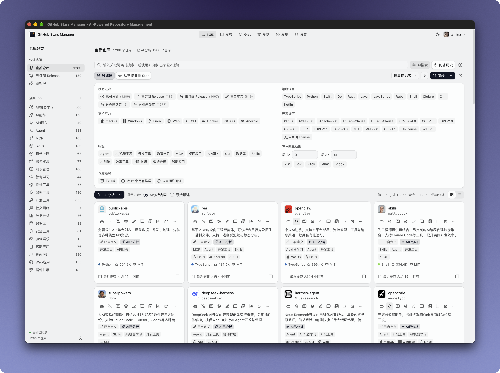
      <br />
      <strong>Slice thousands of stars in seconds</strong> — Combine filters across AI status, platform (macOS/Linux/Docker/CLI), license, star range, recent pushes, and category locks.
    </td>
  </tr>
  <tr>
    <td width="50%" valign="top">
      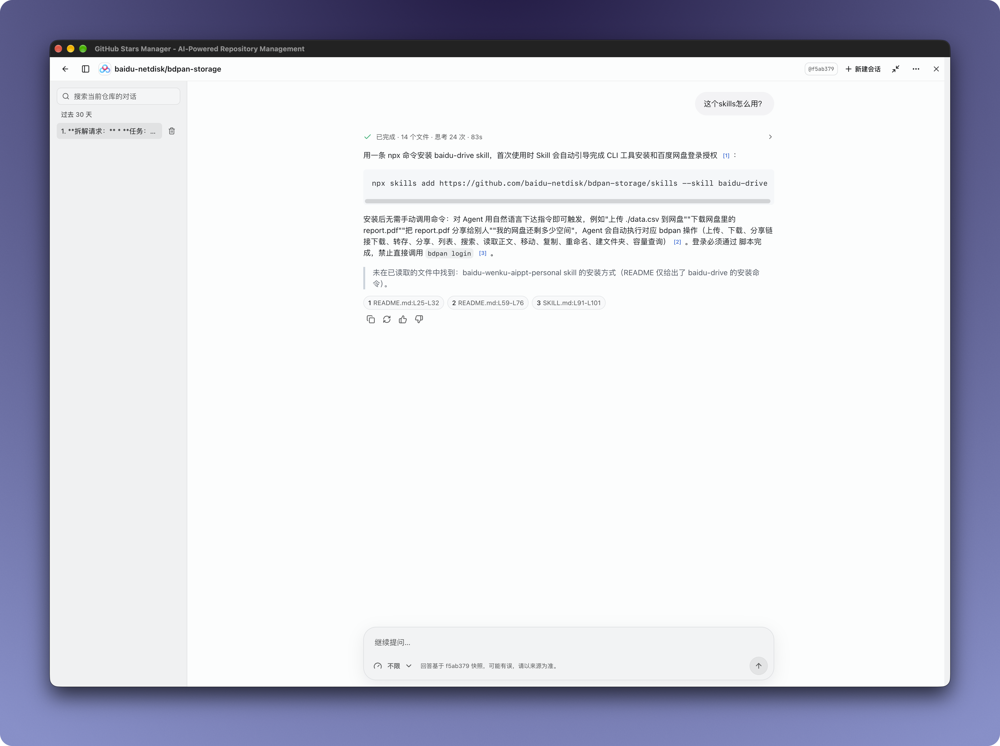
      <br />
      <strong>Commit-pinned Repository Q&amp;A</strong> — Ask focused repo questions with README/docs fast-path, streaming answers, transparent file traces, and clickable <code>file:line</code> citations.
    </td>
    <td width="50%" valign="top">
      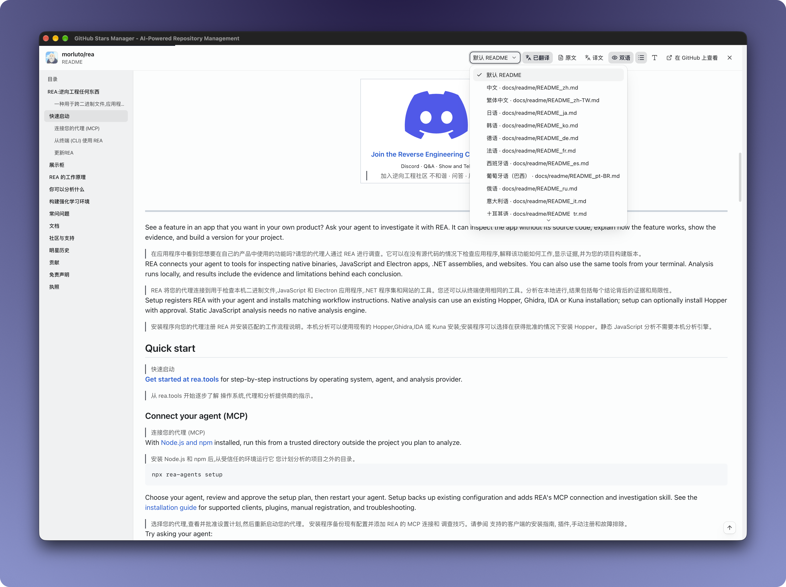
      <br />
      <strong>In-app bilingual README reader</strong> — Read GitHub-flavored Markdown (Alerts, KaTeX, Mermaid) with auto-TOC, locale README switching, and paragraph-by-paragraph bilingual translation.
    </td>
  </tr>
  <tr>
    <td width="50%" valign="top">
      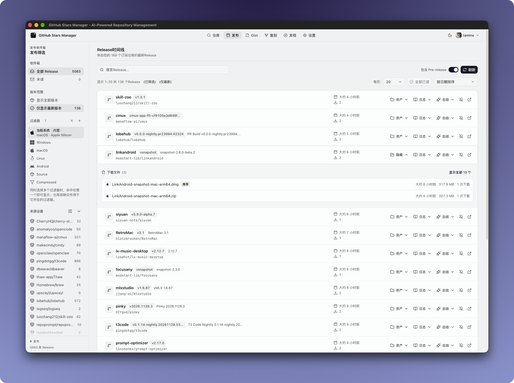
      <br />
      <strong>Release tracking with Current System filter</strong> — Auto-detects your OS and CPU architecture to highlight recommended installers, with AI changelog summaries and aria2 downloads.
    </td>
    <td width="50%" valign="top">
      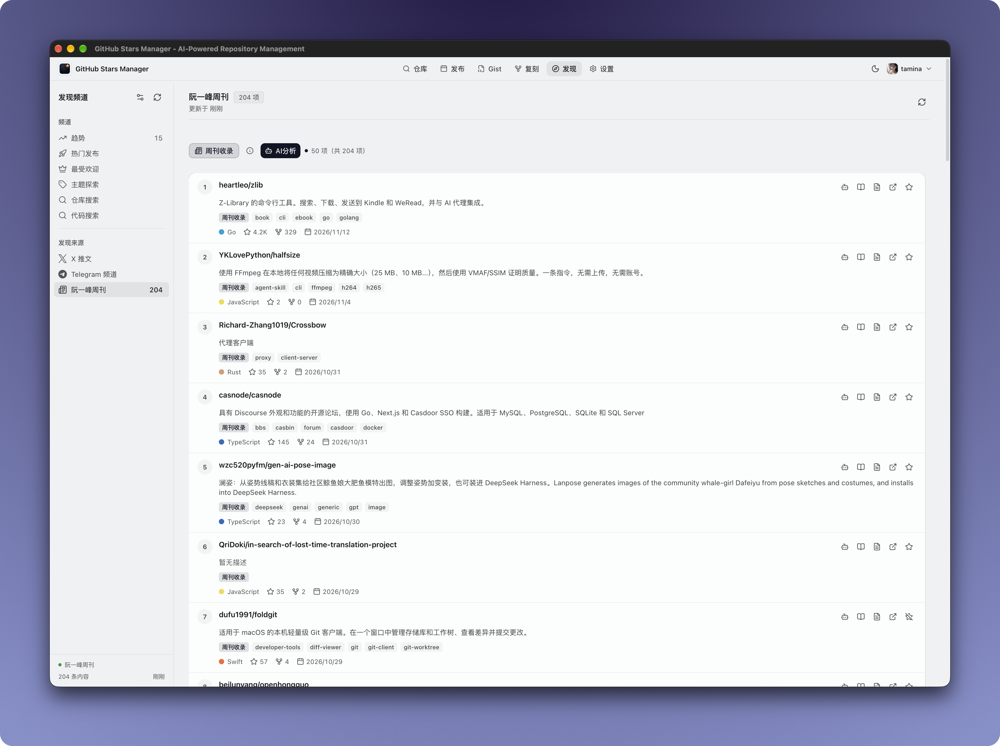
      <br />
      <strong>Discovery Center &amp; Global Code Search</strong> — Track GitHub Trending (with rank history &amp; streaks), 8 built-in channels (X, Telegram, newsletters), custom RSS/Atom/JSON feeds, and public code search.
    </td>
  </tr>
</table>

---

## Key Capabilities

<table>
  <tr>
    <td width="50%" valign="top">

**AI Organization, Bilingual Reading & Batch Import**
- Auto-sync all stars, then batch-generate summaries, tags, platforms, and categories with pause/resume and **locked categories** AI never overwrites.
- **Star from Links:** paste prose, Markdown, URLs, or JSON to extract, preview (with README), and batch-star up to 50 repos (keeps 10-item per-account history).
- **Bilingual README & Auto-Translated Descriptions:** near-fullscreen reader with TOC, GFM Alerts, KaTeX, Mermaid, multi-language README switching, and Original / Translated / Bilingual modes.

</td>
    <td width="50%" valign="top">

**Semantic Vector Search & "Find Similar"**
- Powered by [Cloudflare Vectorize](https://developers.cloudflare.com/vectorize/) with a **one-click CLI deploy wizard** (`npm run deploy:vector`) — no dashboard clicking required.
- Incremental indexing, auto-detected vector dimensions, and **no-reindex reranking** (SiliconFlow `BAAI/bge-reranker-v2-m3` or LLM reranking).
- Upgraded **3-stage no-vector AI fallback** (query expansion + local lexical recall + LLM selection) when Vectorize isn't enabled, plus **Find similar repositories** on every repo card.

</td>
  </tr>
  <tr>
    <td width="50%" valign="top">

**Commit-Pinned Repository Q&A**
- Rebuilt with a **README/docs fast-path**, automatic intent rewriting, explicit evidence gates, a **50 MB local snapshot cache**, and real streaming responses.
- Choose task depth (*Default / Quick / Deep / Unlimited*), search Release notes & Issues, inspect clickable `file:line` citations with hover previews, and jump across chats in the **Global Q&A History drawer**.

</td>
    <td width="50%" valign="top">

**Smart Release Tracking**
- Aggregate releases from starred, watched, or custom repositories in one inbox with **Latest Version Only** mode and AI changelog summaries.
- Built-in **Current System** filter matches your OS and CPU architecture automatically; layer keyword blacklists and per-filter include/exclude repo rules, then download in-browser or via aria2 RPC.

</td>
  </tr>
  <tr>
    <td width="50%" valign="top">

**8-Channel Discovery & Global Code Search**
- Browse **8 built-in channels**: Trending (with daily ranking history, streaks & star growth), Hot Release, Most Popular, Topic, X Tweets, Telegram Channels, Ruanyifeng Weekly, and Repo Search (including AI Semantic Search mode).
- Add up to **10 custom RSS/Atom/JSON feeds**, hide/show channels, and run **Global Code Search** across public GitHub code with path, extension, and language filters.

</td>
    <td width="50%" valign="top">

**Redesigned Workspace, 16 Themes & Multi-Account**
- Unified desktop Workspace Shell with per-module sidebars, **16 curated themes** (independent light/dark palettes, follow-system mode, custom accent/radius/font scale), toggleable repo card fields, and **draggable card quick actions**.
- **Multi-Account Switching** via storage-boundary isolation: separate local IndexedDB/state, per-profile backend SQLite & MCP endpoints (`X-GSM-Profile` / `?profile=<id>`), and cross-profile WebDAV/Vectorize conflict protection.
- Also includes **Fork sync & GitHub Actions**, **Gist vault** with AI summaries, and **bidirectional GitHub Lists sync**.

</td>
  </tr>
</table>

<details>
<summary>More Views — Forks, Gists, 16 Themes &amp; AI Config</summary>

<br />

<table>
  <tr>
    <td width="50%" valign="top">
      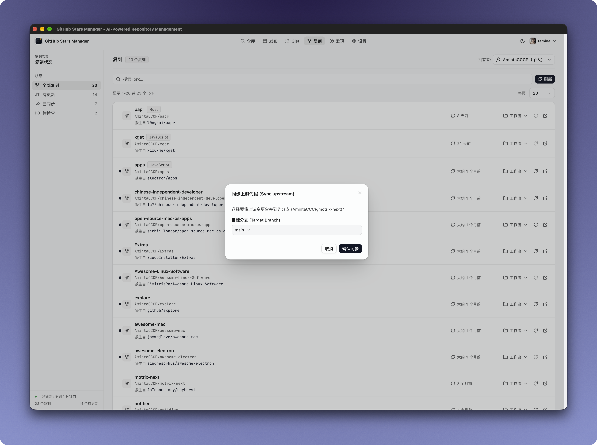
      <br />
      <strong>Fork Management</strong> — Track upstream commits across all forks, sync into any target branch with conflict handling, and trigger GitHub Actions workflows inline.
    </td>
    <td width="50%" valign="top">
      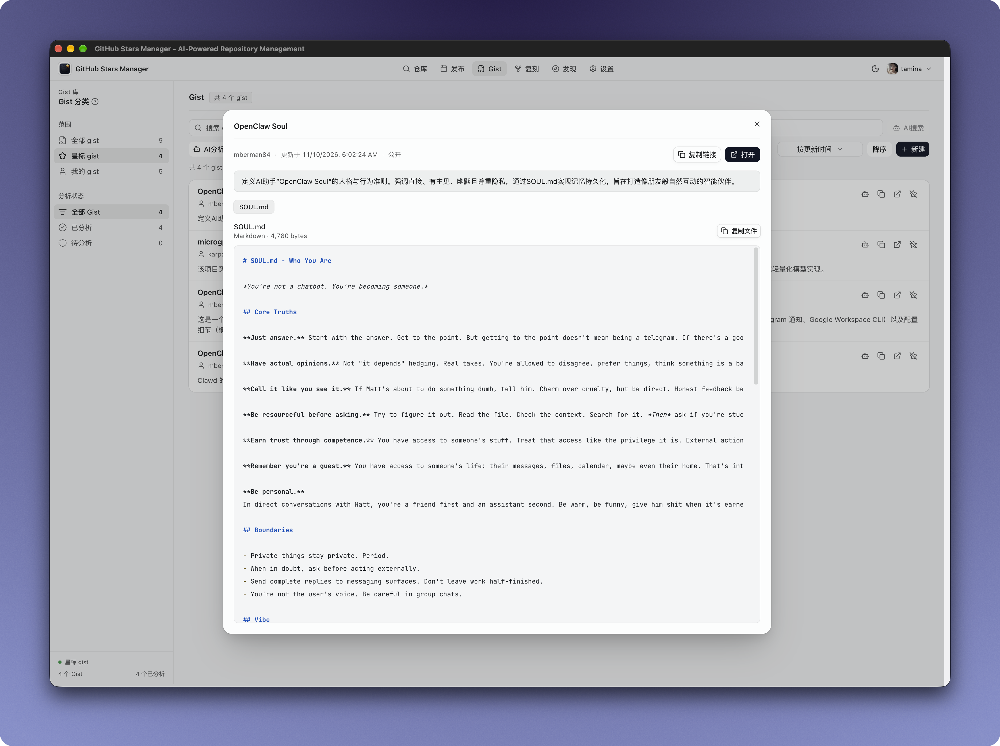
      <br />
      <strong>Gist Vault</strong> — Manage personal and starred Gists with a multi-file editor, AI summaries, semantic search, syntax highlighting, and one-click copy.
    </td>
  </tr>
  <tr>
    <td width="50%" valign="top">
      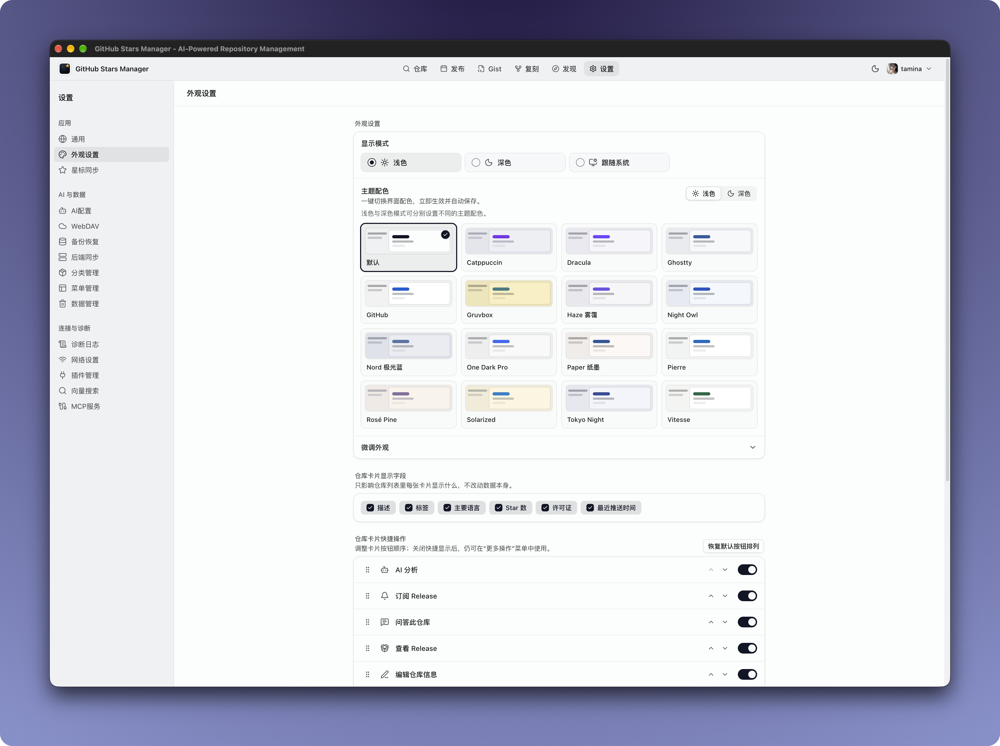
      <br />
      <strong>16 Themes &amp; Card Customization</strong> — Pick separate light/dark palettes from 16 built-in themes, toggle visible repo card fields, and drag to reorder card quick actions.
    </td>
    <td width="50%" valign="top">
      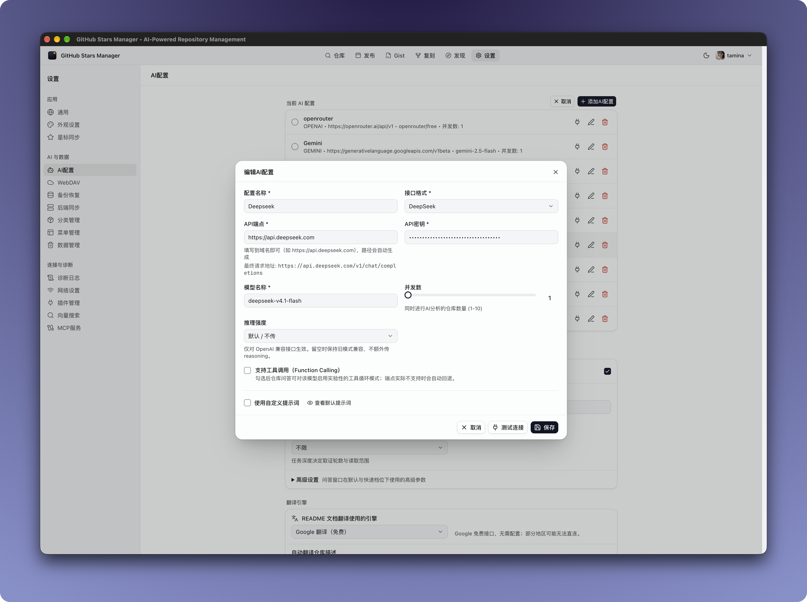
      <br />
      <strong>Multi-Model AI Config</strong> — Switch between OpenAI, Anthropic, Ollama, DeepSeek, OpenRouter, or custom endpoints with 1–10 concurrency, reasoning effort, tool calling, custom prompts, and README translation engine settings.
    </td>
  </tr>
</table>

</details>

<details>
<summary>Full Settings Reference (15 Tabs across 3 Groups)</summary>

| Group | Tabs | What you can configure |
|-------|------|------------------------|
| **Application** | General · Appearance · Star Sync | 10 UI languages, auto-launch & minimize-to-tray, auto-update toggle; 16 themes, follow-system, custom tokens, card fields & draggable quick actions; GitHub Lists bidirectional sync |
| **AI & data** | AI Config · WebDAV · Backup · Backend · Categories · Menu · Data Management | Multi-provider LLM configs (concurrency, reasoning effort, tool calling, prompts, Q&A budgets, README translation); WebDAV (incl. custom `User-Agent`); incremental backup/restore; self-hosted backend URL, `API_SECRET`, & per-device routing (`auto`/`backend`/`browser`); category colors/locks; top nav visibility & order; JSON import/export & reset |
| **Connection & diagnostics** | Diagnostic Logs · Network · Plugin Management · Vector Search · MCP Server | Full-stack log viewer with auto-redaction & diagnostic bundle export; HTTP/SOCKS5 proxy & aria2 JSON-RPC; Desktop Plugin Marketplace & permissions; Cloudflare Vectorize & reranking; local/remote MCP server |

</details>

> [!NOTE]
> **Repository Q&A scope:** The Q&A assistant is built for focused questions about a single repository. It does not index every file in the codebase and may occasionally return incomplete evidence or decline to answer. For whole-codebase debugging, multi-file refactoring, or code edits, clone the repo locally and use a dedicated coding agent.

---

## Desktop Plugin Ecosystem

Extend the **Electron desktop client** with community and local plugins via the built-in **Plugin Marketplace** — browse and search by source, install or update in one click, add external GitHub registries, and inspect permission changes, revocations, or blocks before enabling.

Official showcase plugins in [`examples/plugins/`](examples/plugins/):
- **Repo Insights** (`repo-insights`) — Live per-repo health dashboard: health score, 52-week commit activity, code churn, contributors, bus factor, release cadence, language breakdown, security advisories, and 6-axis health radar.
- **Repo Info Card** (`repo-info-card`) — AI-generated shareable editorial repo cards in 3 visual styles, custom aspect ratios, and 10+ languages with live HTML/code preview and `@2x` PNG export.
- **Repo Custom Fields** (`repo-custom-fields`) — Compact popup to attach clickable URLs, install commands/code snippets, and Markdown notes directly to any repo.
- Also ships `markdown-exporter` and `smart-release-recommender`.

<table>
  <tr>
    <td width="50%" valign="top">
      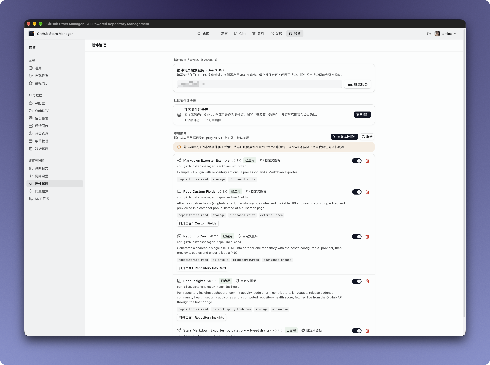
      <br />
      <strong>Plugin Marketplace &amp; Permissions</strong> — Browse community registries, toggle plugins, and audit explicit permissions (<code>repositories:read</code>, <code>ai:invoke</code>, <code>network:*</code>, <code>storage</code>).
    </td>
    <td width="50%" valign="top">
      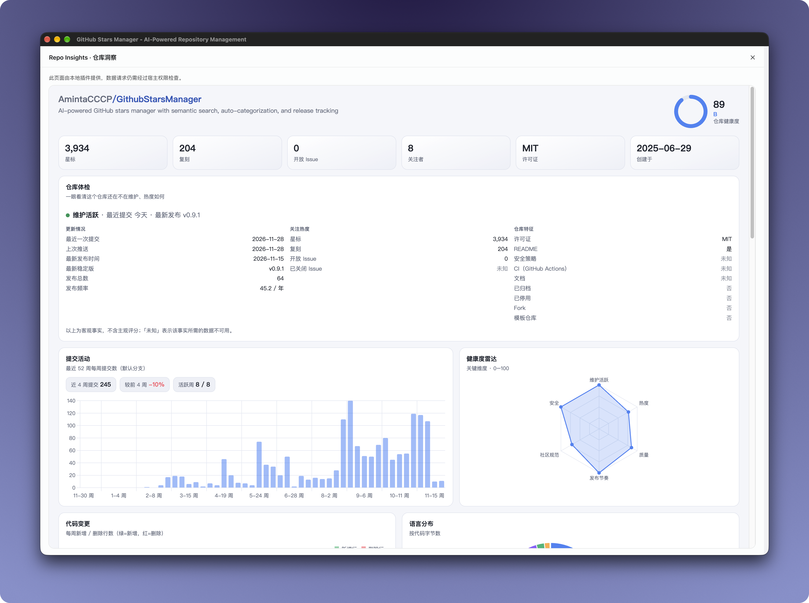
      <br />
      <strong>Repo Insights</strong> — Run objective repository due diligence with health score, 52-week commit charts, release cadence, and 6-axis radar without leaving the app.
    </td>
  </tr>
  <tr>
    <td width="50%" valign="top">
      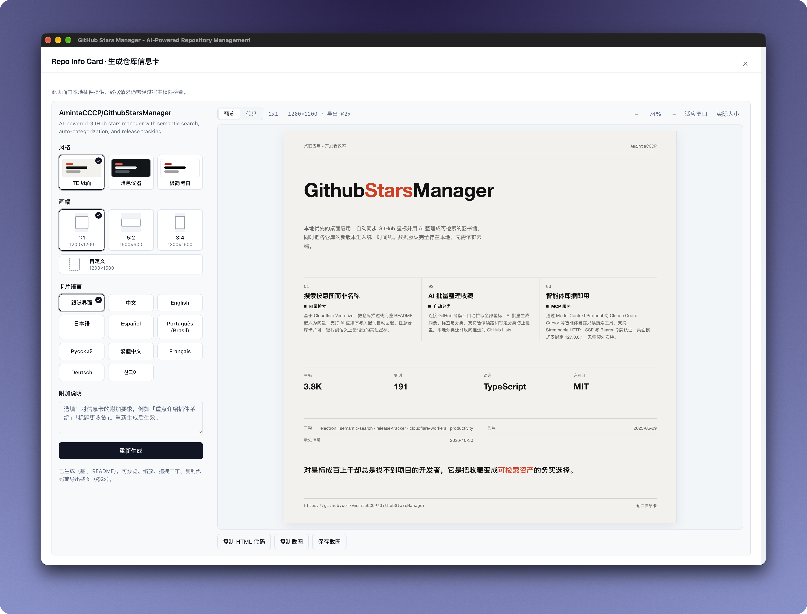
      <br />
      <strong>Repo Info Card</strong> — Generate designer-grade editorial repo cards in 3 styles, multiple ratios, and 10+ languages, then copy HTML or save <code>@2x</code> PNGs.
    </td>
    <td width="50%" valign="top">
      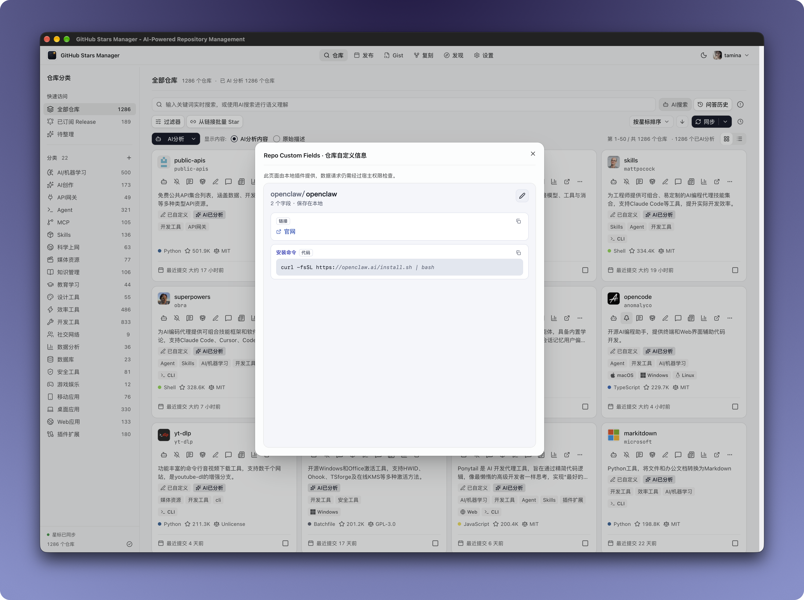
      <br />
      <strong>Repo Custom Fields</strong> — Turn starred repos into your personal handbook by attaching doc links, copyable install commands, and Markdown notes.
    </td>
  </tr>
</table>

**Trust model & docs:** Local plugins are **Electron desktop only** (browser and Docker frontend builds do not include the plugin host). Installed plugins stay disabled until you explicitly grant their Manifest permissions. Worker plugins run as isolated Node.js processes (**not a security sandbox**); page plugins render inside a restricted iframe. Enable via **Settings → Plugins**.

- [Plugin Usage Guide (Wiki)](https://github.com/AmintaCCCP/GithubStarsManager/wiki/Plugin-Usage-EN) — install, enable, permissions, and where plugin actions appear
- [Plugin Development Guide (Wiki)](https://github.com/AmintaCCCP/GithubStarsManager/wiki/Plugin-Development-EN) — Manifest format, Worker API, page bridge, and platform limits
- [Plugin V1 Development Reference](docs/plugins/v1-development.md) — in-repo V1.4–V1.6 technical spec & API reference
- Examples: [`examples/plugins/`](examples/plugins/)

---

## Quick Start

### Desktop Client (Recommended)

No Node.js or CORS setup required — download the slimmed (~100 MB asar-packed) native installer for **macOS, Windows, or Linux**:

- **[Download Latest Release](https://github.com/AmintaCCCP/GithubStarsManager/releases)**
- Includes **auto-launch**, **minimize-to-tray** (with 10-language tray menu & Restart App), **auto-update toggle** with per-version "Don't remind me", local **MCP server**, and **Plugin Marketplace**.
- **macOS Gatekeeper:** The DMG ships with a built-in **Fix Damaged App** helper if macOS flags the unsigned app on first launch.

### Docker Self-Host

Pre-built images are published to GHCR — no local build required. Existing Docker users should keep using the unchanged two-service Compose deployment:

```bash
docker pull ghcr.io/amintacccp/github-stars-manager-server:latest
docker pull ghcr.io/amintacccp/github-stars-manager-frontend:latest
docker-compose up -d
```

Frontend runs on port `8080`, backend on port `3000`, with data persisted in a Docker volume. This split deployment remains the recommended choice when you want to version, operate, or scale frontend and backend independently.

An **optional single-container full-stack image** (`ghcr.io/amintacccp/github-stars-manager-fullstack`) is also available if you prefer one container, one tag, and one volume serving the web UI, `/api`, and MCP endpoints from one origin. Set `API_SECRET` in a root `.env` file first — the full-stack Compose file refuses to start an unauthenticated deployment:

```bash
API_SECRET=replace-with-a-long-random-secret
docker compose -f docker-compose.fullstack.yml up -d
```

The canonical image role names are `-frontend`, `-backend`, and `-fullstack`; the existing `-server` backend image remains a compatibility alias for current deployments. Formal `vX.Y.Z` Docker tags match the root `package.json` version (`0.9.1`), while `latest` and `sha-*` are development and traceability tags.

> [!NOTE]
> If the GHCR package is private, run `docker login ghcr.io` first using a [GitHub PAT](https://github.com/settings/tokens) with `read:packages` scope.

See [DOCKER.md](DOCKER.md) and the [single-container full-stack guide](DOCKER.md#optional-single-container-full-stack-deployment) for migration, backup, and rollback instructions.

### Optional Backend Server

The web app works purely in the browser (`localStorage`), or you can connect the optional **Express + SQLite** backend for:
- **Cross-device sync** & **per-profile multi-account isolation**
- **CORS-free API proxying** for AI providers and WebDAV
- **Encrypted token storage** (API keys never exposed to the browser network tab)
- **Network proxy forwarding** (HTTP/SOCKS5) and **aria2 RPC download proxying**
- **Backend-restore login** ("Already have backend data" on the login screen)

To pin versions or customize secrets with split Compose, create a `.env` file:

```bash
API_SECRET=your-secret
ENCRYPTION_KEY=your-key
BACKEND_IMAGE_TAG=0.9.1   # pin backend image version (default: latest)
FRONTEND_IMAGE_TAG=0.9.1  # pin frontend image version (default: latest)
```

<details>
<summary>Backend-only <code>docker run</code> &amp; manual Node.js setup</summary>

**Backend only (`docker run`):**
```bash
# Basic — auto-generated API secret stored in /app/data/.api-secret, port 3000
docker run -d --name github-stars-backend \
  -v github-stars-data:/app/data \
  -p 3000:3000 \
  ghcr.io/amintacccp/github-stars-manager-server:latest

# With explicit secret and encryption key
docker run -d --name github-stars-backend \
  -v github-stars-data:/app/data \
  -p 3000:3000 \
  -e API_SECRET="your-secret" \
  -e ENCRYPTION_KEY="your-key" \
  ghcr.io/amintacccp/github-stars-manager-server:latest
```

**Manual setup:**
```bash
cd server
npm install
npm run dev
```

</details>

> [!IMPORTANT]
> **Upgrading an existing deployment (Security Hardening):** The backend no longer runs with authentication disabled when `API_SECRET` is unset.
> 1. On first start, the backend generates a secure random secret and writes it to `data/.api-secret` inside the data volume — **the secret value is never printed to logs**. Retrieve it once via:
>    - Compose: `docker compose exec backend cat /app/data/.api-secret`
>    - Standalone container: `docker exec <backend-container> cat /app/data/.api-secret`
>    - Or read the file directly from the volume, or set `API_SECRET` explicitly in the server environment.
> 2. Enter this secret once as the **API Secret** in the web UI (login screen or **Settings → Backend Server**). Existing encrypted data is unaffected.
> 3. Optionally pin `API_SECRET` in `.env` (an explicit env var always takes precedence). For zero-config local development only, set `ALLOW_INSECURE_NO_AUTH=1` (`npm run dev` sets this for you).
> 4. **Back up `data/.encryption-key`:** if you rely on the auto-generated key, it lives on the same volume as your encrypted database — losing the volume makes stored secrets (GitHub token, AI keys, WebDAV passwords) unrecoverable.

**Connecting frontend to backend:**
1. Open **Settings → Backend Server** (or choose **Already have backend data** on the login screen).
2. Enter the backend URL and **API Secret** (from `data/.api-secret` or your explicit `API_SECRET`).
3. Click **Test Connection** and use **Sync to Backend** / **Sync from Backend** (per-device request routing can be set to `auto`, `backend`, or `browser`).

<details>
<summary>Backend Environment Variables</summary>

| Variable | Required | Description |
|----------|----------|-------------|
| `API_SECRET` | No | Bearer token for `/api` authentication. If unset, a random secret is generated on first start and persisted to `data/.api-secret`; all `/api` requests require it as a Bearer token. |
| `ALLOW_INSECURE_NO_AUTH` | No | Set to `1` or `true` to restore legacy zero-config dev mode when `API_SECRET` is unset (`/api` accepts unauthenticated requests and logs a loud warning). **Never enable on a publicly reachable deployment.** |
| `ENCRYPTION_KEY` | No | AES-256 key for encrypting stored secrets. Auto-generated to `data/.encryption-key` if unset. |
| `PORT` | No | Server port (default: `3000`). |
| `CSP_CONNECT_SRC` | No | Comma-separated extra origins appended to the `connect-src` CSP directive for custom AI provider or vector-search worker endpoints called directly from the browser (e.g. `https://ai.example.com,https://worker.example.org`). |
| `CSP_UPGRADE_INSECURE_REQUESTS` | No | Defaults to on (`upgrade-insecure-requests`). Set to `false` when serving the full-stack image over plain HTTP (e.g. `http://<lan-ip>:3000`); otherwise browsers rewrite the SPA's own assets to `https://` and the page stays blank. Only disable for HTTP deployments not placed behind TLS. |

</details>

### Run from Source & Static Hosting

```bash
git clone https://github.com/AmintaCCCP/GithubStarsManager.git
cd GithubStarsManager
npm install
npm run dev
```

> [!TIP]
> Under `npm run dev`, direct browser calls to some AI providers or WebDAV servers may hit CORS limits. Use the Desktop client, Docker deployment, or run the local backend (`cd server && npm run dev`) to proxy requests cleanly.

The production build (`npm run build` → `dist/`) is a static site that deploys directly to **Netlify**, **Vercel**, **GitHub Pages** (`gh-pages`), **Cloudflare Pages**, or any static HTTP server (nginx, Caddy).

---

## Integrations

### AI Service Configuration

Configure one or more providers in **Settings → AI Config** and test connections before saving:

- **OpenAI** (GPT-4o / GPT-4 / o-series) · **Anthropic** (Claude) · **Ollama** (local models, no API key) · **Any OpenAI-compatible API** (DeepSeek, OpenRouter, SiliconFlow, self-hosted endpoints)
- Tune batch analysis **concurrency (1–10)**, **reasoning effort**, **function calling**, custom system prompts, Q&A retrieval budgets, and your **README translation engine**.

### Vector Semantic Search

High-precision natural-language search and **Find similar repositories** powered by [Cloudflare Vectorize](https://developers.cloudflare.com/vectorize/). Your client generates embeddings via your chosen provider, while a minimal Cloudflare Worker proxies vector upsert/query/delete operations.

#### One-Click Interactive Deployment Wizard (Recommended)

Deploy the Vectorize Worker without touching the Cloudflare web dashboard — the interactive TUI in [`cloudflare-worker/`](cloudflare-worker/README.md) guides every step via Wrangler CLI:

```bash
# From the repository root
npm run deploy:vector

# Or inside cloudflare-worker/
cd cloudflare-worker
./deploy.sh                  # macOS / Linux (or: node deploy.mjs)
.\deploy.ps1                 # Windows PowerShell (or double-click deploy.bat)
npm run deploy:interactive   # Cross-platform NPM script
```

**Why use the wizard:**
- **Zero dashboard clicking** — automates index probing, `AUTH_TOKEN` secret injection, and Worker deployment end-to-end.
- **Preserves existing index & data** — keeps your existing Vectorize index and vectors intact across updates with no re-indexing required.
- **Saved local config for one-click redeploy** — stores parameters locally in `.deploy-config.json` so future updates redeploy in one step.
- **Automatic post-deploy verification** — tests connectivity right after deployment and prints a copy-ready Worker URL and auth token card.

See [cloudflare-worker/README.md](cloudflare-worker/README.md) for full wizard details and manual step-by-step instructions.

#### Search Capabilities & Embedding Providers

- **Flexible indexing:** Index repo descriptions or full READMEs, run **Incremental Index** updates, and **auto-detect** vector dimensions.
- **No-reindex reranking:** Enable SiliconFlow `BAAI/bge-reranker-v2-m3` or LLM reranking anytime without rebuilding your vector index.
- **Automatic fallback:** When Vector Search is disabled or unreachable, AI Search falls back to the 3-stage keyword + lexical + LLM pipeline.
- **Find similar repositories:** Click **Find similar** on any repo card to open a ranked semantic neighborhood excluding the anchor repo.

| Embedding Provider | Example Models | Dimensions |
|--------------------|----------------|------------|
| OpenAI | `text-embedding-3-small` / `large` | 1536 / 3072 |
| Gemini | `text-embedding-004` | 768 |
| Cohere | `embed-multilingual-v3.0` | 1024 |
| Ollama (local) | `nomic-embed-text` / `bge-m3` | 768 / 1024 |
| SiliconFlow | `BAAI/bge-large-zh-v1.5` / `BAAI/bge-m3` | 1024 |
| OpenAI-compatible | Custom model | Custom / Auto-detect |

> [!WARNING]
> Changing the embedding model requires clicking **Rebuild Index** — different models produce incompatible vector dimensions.

<p align="center">
  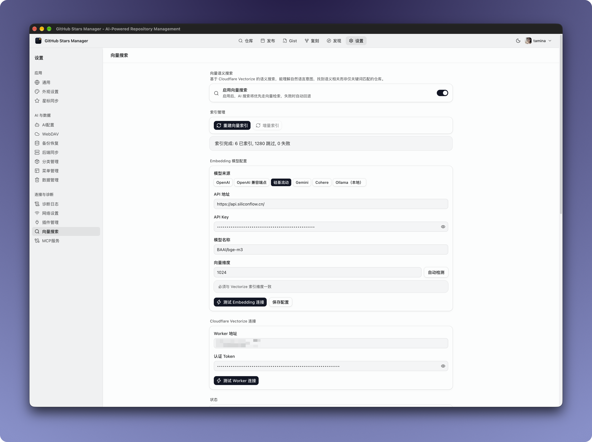
</p>

### MCP Server

Give coding agents (**Claude Code**, **Cursor**, etc.) direct read-only access to your AI-enriched stars via the [Model Context Protocol](https://modelcontextprotocol.io/) — zero extra install required.

- **Streamable HTTP** (preferred): `POST /mcp` on the backend/Docker origin, or `http://127.0.0.1:3927/mcp` in Electron desktop mode.
- **Legacy SSE:** `/mcp/sse` + `/mcp/sse/messages` (backend) or `/sse` + `/messages` (desktop) for older clients.
- **Stable Bearer auth:** Uses a dedicated `gsm_mcp_...` token generated on first enable and persisted across restarts until reset (**separate** from `API_SECRET`).
- **Multi-account profile targeting:** Scope requests to a specific account profile via `X-GSM-Profile` header or `?profile=<id>`.
- **Desktop & pure-SPA notes:** Electron binds loopback (`127.0.0.1`) only (port configurable, default `3927`). Pure browser mode without a backend hides the MCP settings page.

Enable in **Settings → MCP Server** and copy the ready-made JSON config straight into your agent.

<p align="center">
  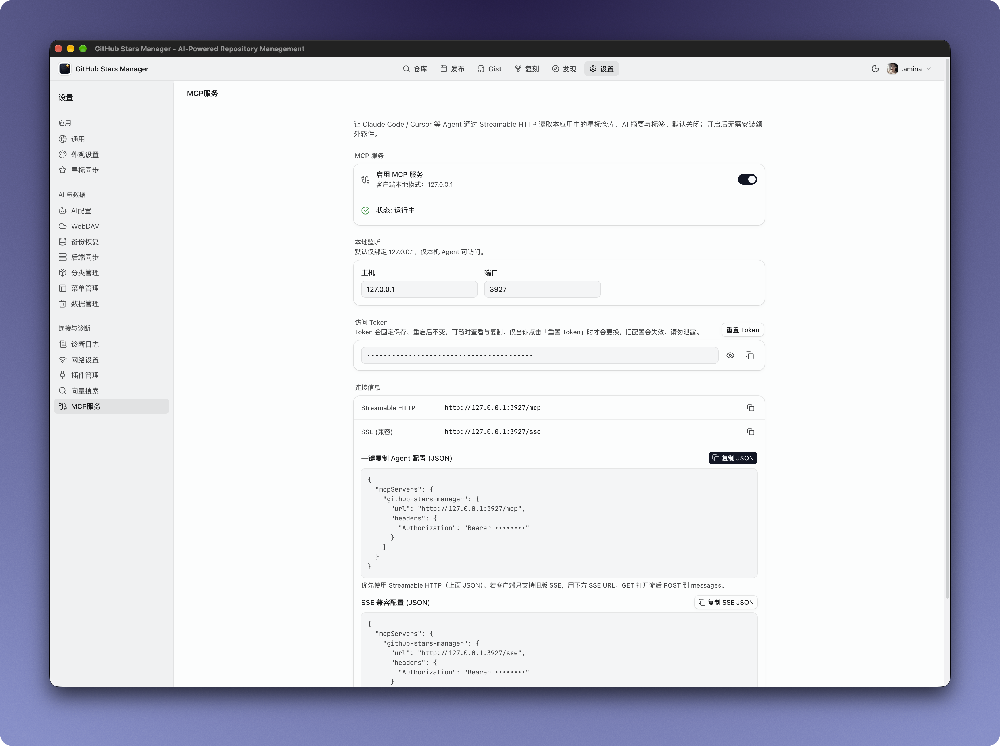
</p>

<details>
<summary>Exposed MCP Tools (10 Read-Only Tools &amp; Query Semantics)</summary>

| Tool | Description |
|------|-------------|
| `gsm_status` | Server status: repo count, vector availability, version, `availableTools`, and `conditionalTools` |
| `gsm_search_repos` | Keyword search with filters (`languages`, `tags`, `platforms`, `licenses`, `category`, stars) and pagination |
| `gsm_get_repo` | Fetch one repo by numeric ID or `owner/repo` with AI-enriched fields |
| `gsm_get_repos` | Batch-fetch up to 50 repos in input order; preserves duplicates and reports partial `not_found` entries |
| `gsm_get_repo_evidence` | Deterministic local repo + cached release evidence with `evidenceFreshness`; missing values stay `null` |
| `gsm_list_categories` | List custom categories |
| `gsm_list_repos_by_category` | List repos in a category with pagination |
| `gsm_stats` | Aggregate stats across languages, AI analysis status, and tags |
| `gsm_find_similar_repos` | Find similar starred repos using the existing vector index (excludes source repo; listed only when Vector Search is enabled) |
| `gsm_vector_search` | Semantic vector search (listed only when Vector Search is configured and enabled) |

**Semantics notes:**
- `gsm_vector_search` accepts optional `languages`, `tags`, `platforms`, `licenses`, `category`, `minStars`, `maxStars`, `isAnalyzed`, and `isSubscribed` filters. When filters are supplied, the Worker returns at most 50 semantic candidates and GithubStarsManager filters locally before truncating to `topK` (not an exact filtered `topK` over the entire corpus). Unfiltered behavior is unchanged.
- `gsm_status` returns `availableTools` (registered for the current config) and `conditionalTools` (the vector-gated tools regardless of current availability).
- `gsm_get_repo_evidence` reads only the local repository database and cached releases, never triggers unbounded GitHub fan-out, and does not infer missing fields or return adoption decisions. `evidenceFreshness` derives from stored repo `updated_at`, analysis timestamps, and cached release `published_at` (unsaved sync timestamps stay `null`).

</details>

### Network Proxy, Remote Download (aria2) & Diagnostic Logs

- **HTTP / SOCKS5 Proxy:** Full HTTP CONNECT and RFC 1929 SOCKS5 auth with protocol-level handshake testing and AES-256-GCM encrypted password storage (Desktop or Backend mode).
- **aria2 JSON-RPC Remote Download:** Start `aria2c --enable-rpc --rpc-listen-port=6800`, configure host/port/secret in **Settings → Network → Remote Download**, and queue release assets straight to aria2 (works in both backend-proxied and direct browser→aria2 modes).
- **Diagnostic Logs:** Inspect unified frontend/backend logs in **Settings → Diagnostic Logs**, toggle debug capture, and export auto-redacted diagnostic bundles for bug reports.

<p align="center">
  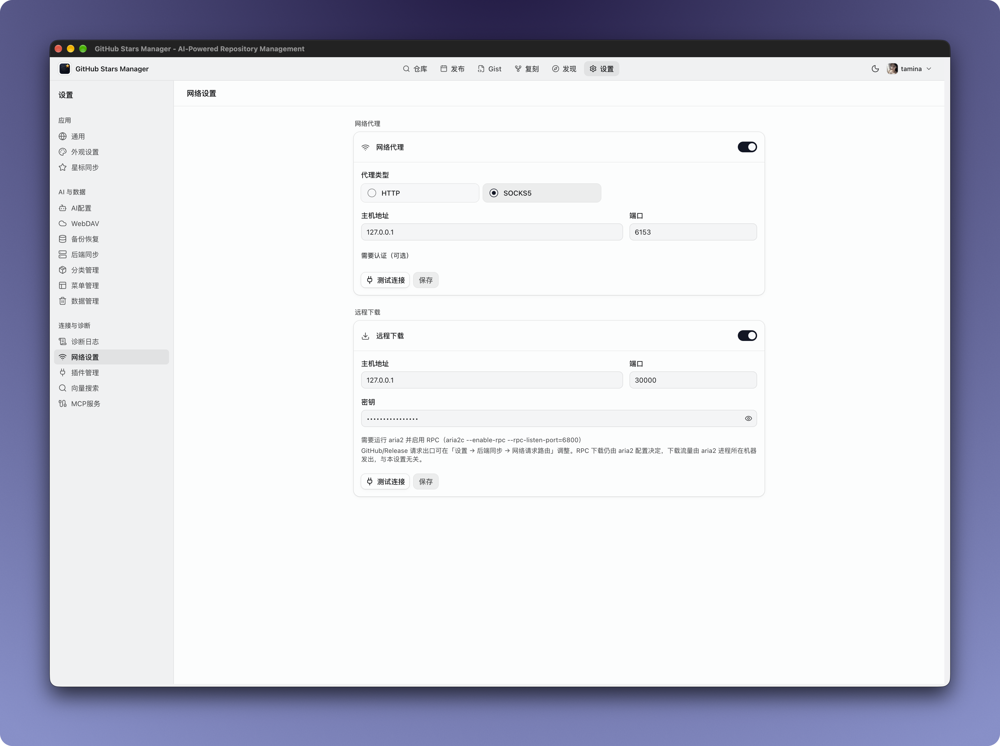
</p>

### GitHub Lists Sync & WebDAV Backup

- **GitHub Lists Bidirectional Sync** (**Settings → Star Sync**):
  - **Pull (GitHub → app):** Switch sync scope to **Starred repos & lists** (persistent) to fetch native [GitHub Lists](https://github.com/features/lists) via GraphQL, apply list names as tags, and map unlocked repos to matching categories with **auto-lock**.
  - **Selective Push (app → GitHub):** Push all or **selected** local categories back as private GitHub Lists with pre-validation against GitHub's 32-list and 32-character limits while preserving memberships in unmanaged lists.
- **WebDAV Backup** (**Settings → WebDAV**): Back up and restore via Jianguoyun, Nextcloud, ownCloud, or any standard WebDAV server — with auto-backup, incremental snapshots, custom `User-Agent` support, and cross-profile conflict protection.

---

## Interface Languages

The UI ships natively in **10 languages**:

`简体中文` · `English` · `日本語` · `Español` · `Português (Brasil)` · `Русский` · `繁體中文` · `Français` · `Deutsch` · `한국어`

- Auto-detects your browser/OS language on first launch; switch anytime in **Settings → General → Language** or on the login screen (desktop tray menu follows too).
- Built-in AI prompts (repo summaries & tags, Gist summaries, Release changelog digests, Repository Q&A) and built-in categories follow the selected UI language automatically.
- Missing keys gracefully fall back to English. Translation improvements via PR are always welcome in [`src/locales`](src/locales).

---

## Tech Stack

- **Frontend:** React 19 · TypeScript · Tailwind CSS 4 · Radix UI (shadcn/ui) · Zustand 5 · Lucide React · Vite 8
- **Desktop:** Electron 45
- **Optional Backend:** Express 5 · better-sqlite3 13 · SQLite

---

## Community, Notes & License

**Who it's for:** Developers juggling hundreds or thousands of starred repos, teams tracking releases systematically, and anyone using AI coding agents who wants their curated GitHub library searchable via MCP.

**Good to know:**
1. Without the optional backend or desktop client, web deployments store data in browser `localStorage` — back up regularly via WebDAV or JSON export.
2. Full transparency from the author: I can't write code — this app is built entirely with AI, originally for my own workflow. If you request a feature or hit a bug, I'll happily try to get it done, though success depends on the AI pulling it off. 😹

**Contributing:** Fork the repo, create a branch (`git checkout -b feature/AmazingFeature`), commit your changes, push, and open a Pull Request. Found a bug or idea? Open an [Issue](https://github.com/AmintaCCCP/GithubStarsManager/issues).

**License:** MIT — see [LICENSE](LICENSE). If GithubStarsManager saves you time, consider giving it a ⭐!

### StarMapper

<a href="https://starmapper.bruniaux.com/AmintaCCCP/GithubStarsManager?utm_source=map-embed&utm_medium=readme&utm_campaign=stargazer-map">
  <picture>
    <source media="(prefers-color-scheme: dark)" srcset="https://starmapper.bruniaux.com/api/map-image/AmintaCCCP/GithubStarsManager?theme=dark" />
    <source media="(prefers-color-scheme: light)" srcset="https://starmapper.bruniaux.com/api/map-image/AmintaCCCP/GithubStarsManager?theme=light" />
    
  </picture>
</a>

### Star History

<a href="https://github.com/AmintaCCCP/GithubStarsManager">
  <picture>
    <source media="(prefers-color-scheme: dark)" srcset="https://starfolio.aminta.top/star-history/githubstarsmanager?theme=dark" />
    <source media="(prefers-color-scheme: light)" srcset="https://starfolio.aminta.top/star-history/githubstarsmanager?theme=light" />
    
  </picture>
</a>
