<div align="center">

<p>
  <a href="README.md">English</a> &nbsp;|&nbsp; <b>简体中文</b>
</p>

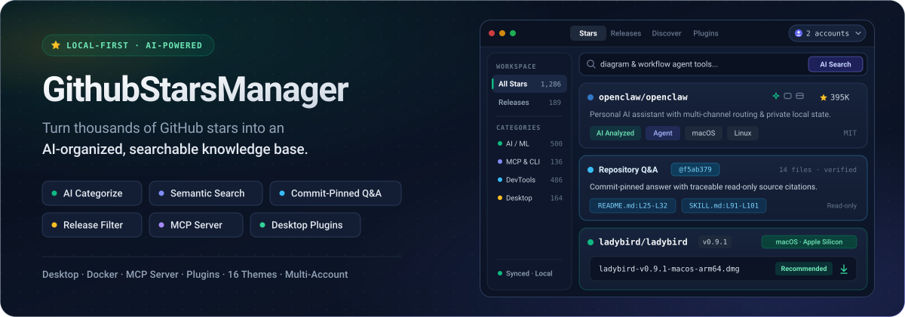

<br />


# GithubStarsManager

**把上千个 GitHub 星标，变成真正搜得到、用得上的本地开源知识库。**

AI 自动摘要与分类 · 向量语义搜索 · 锚定提交的仓库问答 · 智能 Release 追踪 · MCP Agent 接入 · 桌面端插件生态

<p>
  <a href="https://github.com/AmintaCCCP/GithubStarsManager/releases"><b>⬇️ 下载桌面端</b></a>
  &nbsp;·&nbsp;
  <a href="#docker-自托管部署"><b>🐳 Docker 部署</b></a>
  &nbsp;·&nbsp;
  <a href="#快速开始与部署"><b>⚡ 快速开始</b></a>
  &nbsp;·&nbsp;
  <a href="#进阶集成与配置"><b>🧠 向量搜索与 MCP</b></a>
  &nbsp;·&nbsp;
  <a href="https://github.com/AmintaCCCP/GithubStarsManager/wiki/Plugin-Usage"><b>🔌 插件文档</b></a>
</p>

<p>
  
  
  
  
  <a href="https://zread.ai/AmintaCCCP/GithubStarsManager"></a>
  <a href="https://linux.do"></a>
</p>

<p>
  <a href="https://www.producthunt.com/products/githubstarsmanager?embed=true&utm_source=badge-featured&utm_medium=badge&utm_source=badge-githubstarsmanager" target="_blank"></a>
  &nbsp;
  <a href="https://trendshift.io/repositories/28489?utm_source=trendshift-badge&amp;utm_medium=badge&amp;utm_campaign=badge-trendshift-28489" target="_blank" rel="noopener noreferrer"></a>
</p>

</div>

---

## 演示视频

https://github.com/user-attachments/assets/ad3493a0-948a-4de5-8de1-4e9afc46ec4d

---

## 产品界面一览

星标越攒越多，真正需要时却记不起仓库名；订阅了上百个项目，每次发版都要在几十个安装包里手动翻找。GithubStarsManager 把**整理、检索、阅读、追踪、发现与扩展**收进一个清爽的本地工作台。

<div align="center">
  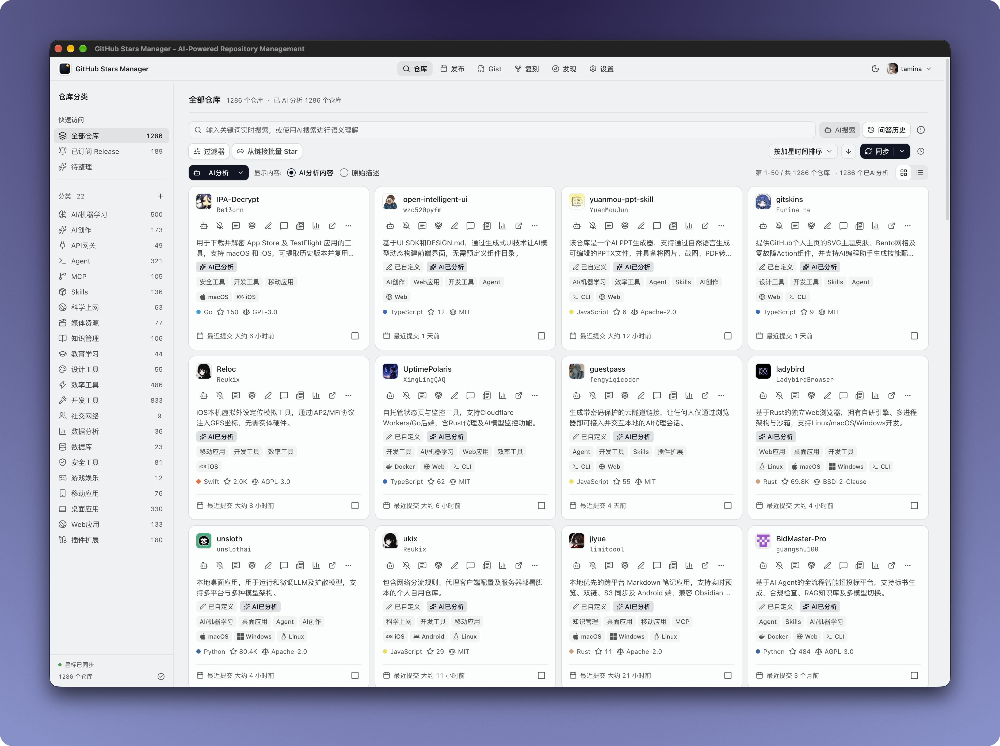
  <br />
  <sub><em>桌面工作台主界面：1,286 个星标按 AI 自动分类归档，卡片呈现中文摘要、支持平台与自定义快捷操作栏，右上角支持一键切换多账号与主题。</em></sub>
</div>

<br />

<table>
  <tr>
    <td width="50%" valign="top">
      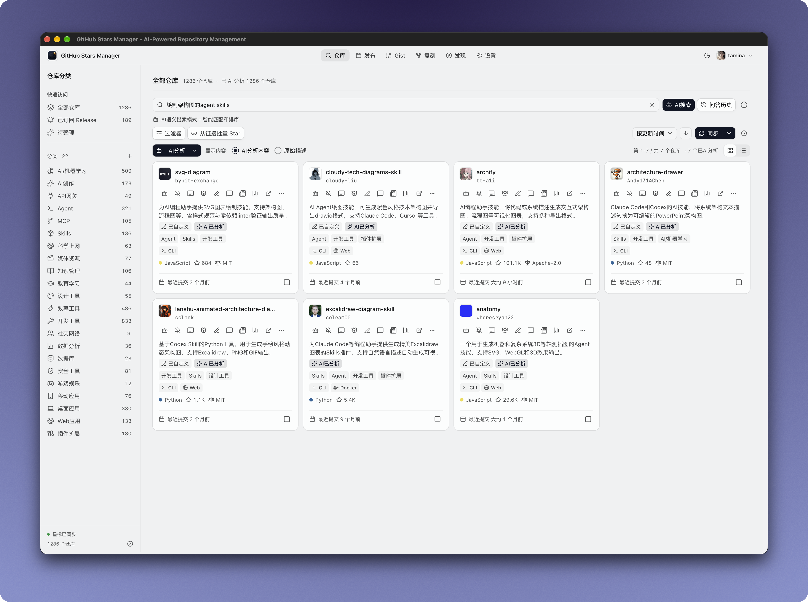<br />
      <b>按意图语义搜索，不必死记仓库名</b><br />
      <sub>输入自然语言描述即可精准召回相关项目，即使仓库名与描述里没有字面关键词也能找到。</sub>
    </td>
    <td width="50%" valign="top">
      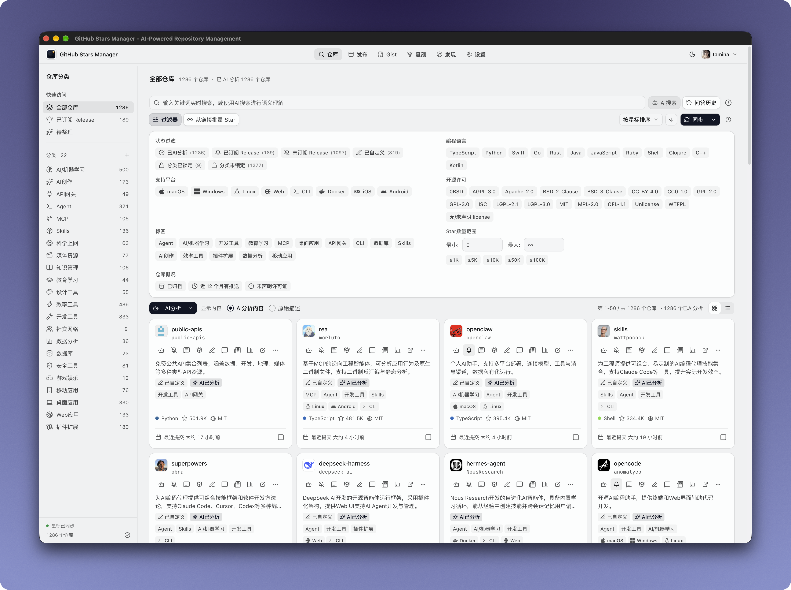<br />
      <b>多维组合筛选，秒级切分上千星标</b><br />
      <sub>按支持平台、开源许可、Star 区间、近 12 个月活跃度、订阅状态与分类锁定自由组合过滤。</sub>
    </td>
  </tr>
  <tr>
    <td width="50%" valign="top">
      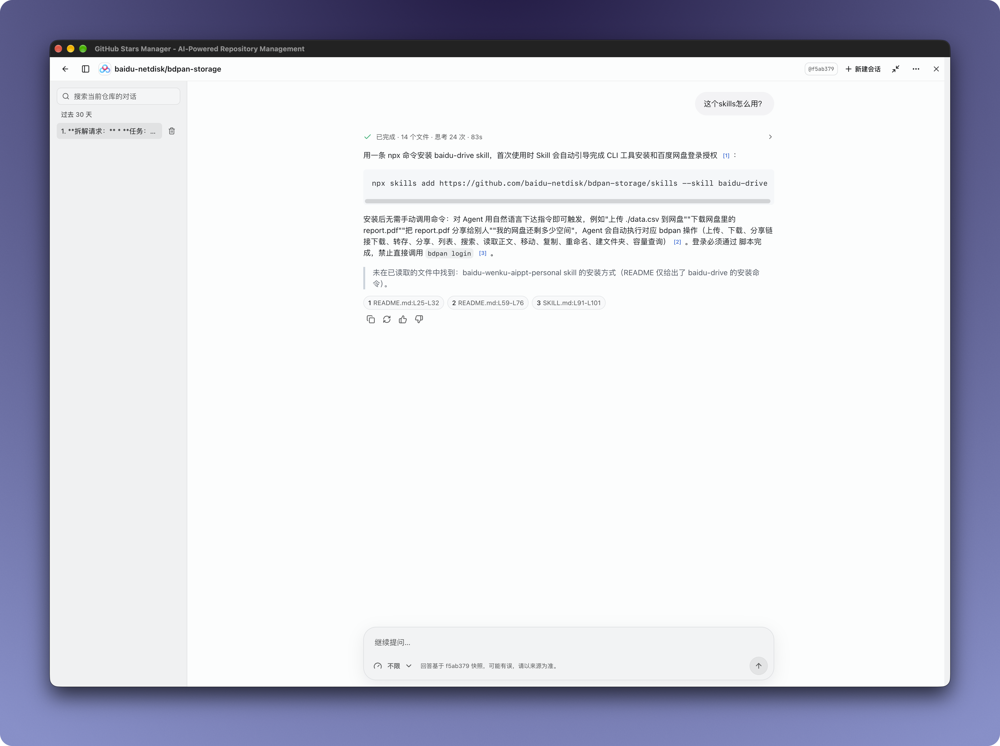<br />
      <b>锚定提交的仓库问答，每句有据可查</b><br />
      <sub>会话锁定特定 commit，透明展示检索轨迹与行级来源引用（悬停预览、点击跳 GitHub），找不到的内容如实告知。</sub>
    </td>
    <td width="50%" valign="top">
      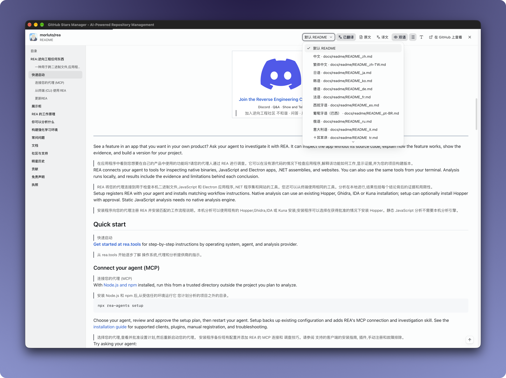<br />
      <b>内置双语 README 阅读器</b><br />
      <sub>自动生成目录、识别仓库自带的多语言 README，支持原文 / 译文 / 段落双语对照阅读，无需离开应用。</sub>
    </td>
  </tr>
  <tr>
    <td width="50%" valign="top">
      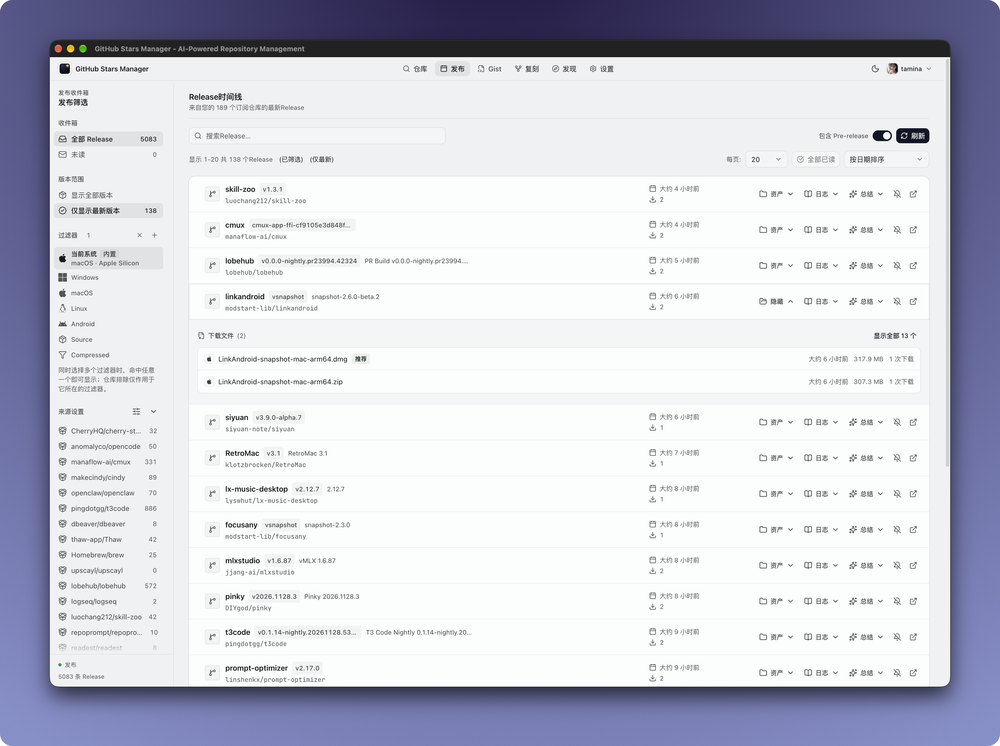<br />
      <b>Release 追踪与「当前系统」智能选包</b><br />
      <sub>汇聚订阅仓库的新版本，自动识别本机 OS 与芯片架构并标记推荐安装包，支持 AI 总结更新日志与一键下载。</sub>
    </td>
    <td width="50%" valign="top">
      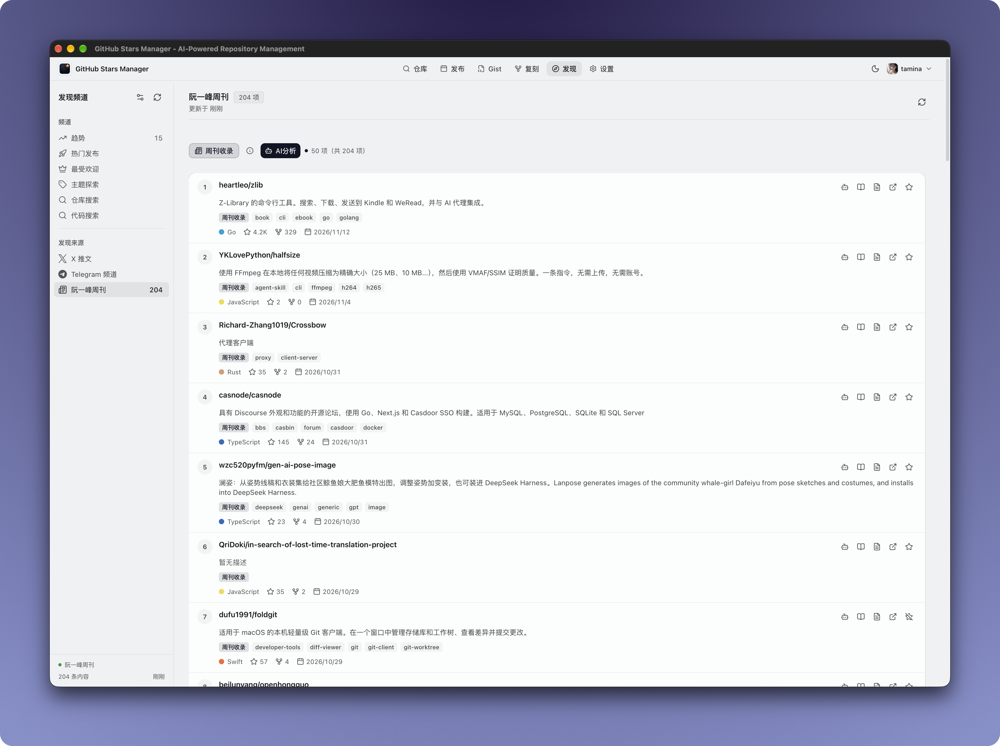<br />
      <b>发现中心与精选技术雷达</b><br />
      <sub>聚合 GitHub 趋势榜、全局代码搜索与 X / Telegram / 阮一峰周刊及自定义订阅源，看到好项目一键 AI 分析收藏。</sub>
    </td>
  </tr>
</table>

<details>
<summary>🖼️ 更多界面 — Fork 管理、Gist 片段库、16 套主题与多模型 AI 配置（点击展开）</summary>

<table>
  <tr>
    <td width="50%" valign="top">
      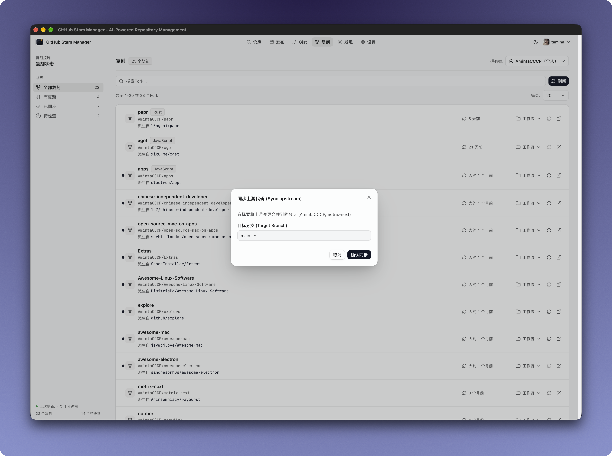<br />
      <b>Fork 上游同步与 Actions 触发</b><br />
      <sub>自动检测上游新提交，支持指定分支一键合并同步，在卡片内直接触发 GitHub Actions 工作流。</sub>
    </td>
    <td width="50%" valign="top">
      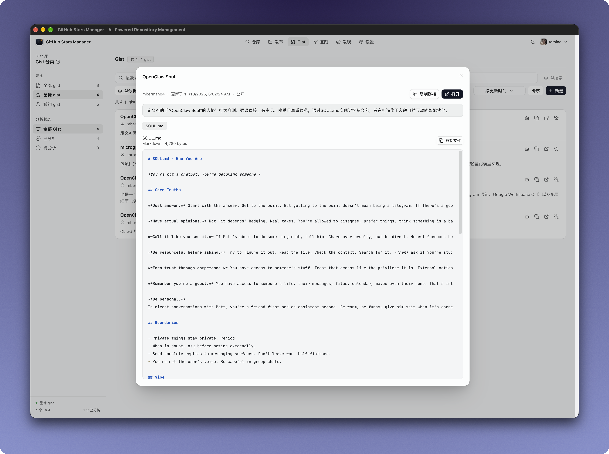<br />
      <b>可搜索的 Gist 代码片段库</b><br />
      <sub>同步个人与星标 Gist，内置多文件编辑器、AI 摘要、语义搜索与语法高亮一键复制。</sub>
    </td>
  </tr>
  <tr>
    <td width="50%" valign="top">
      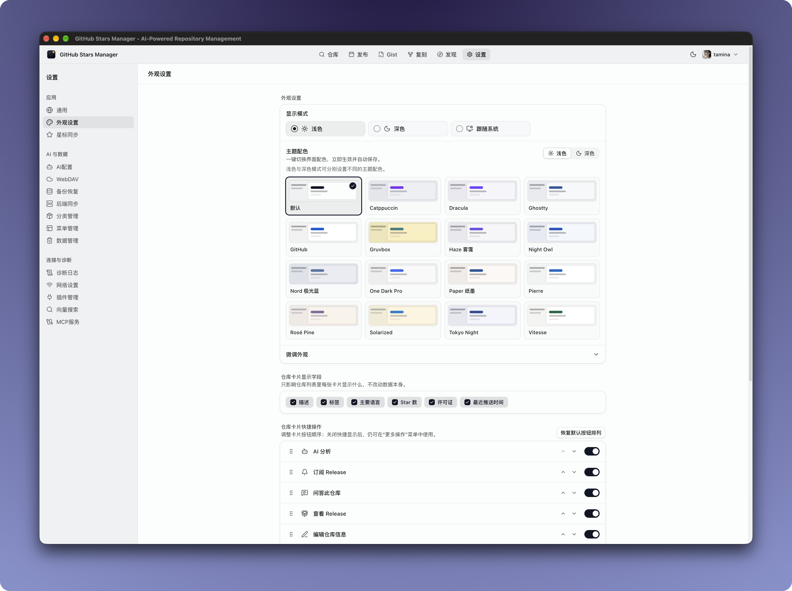<br />
      <b>16 套主题与高度可定制的工作台</b><br />
      <sub>支持跟随系统浅/深色并分别记住主题预设，自由开关卡片字段、拖拽排序快捷操作按钮。</sub>
    </td>
    <td width="50%" valign="top">
      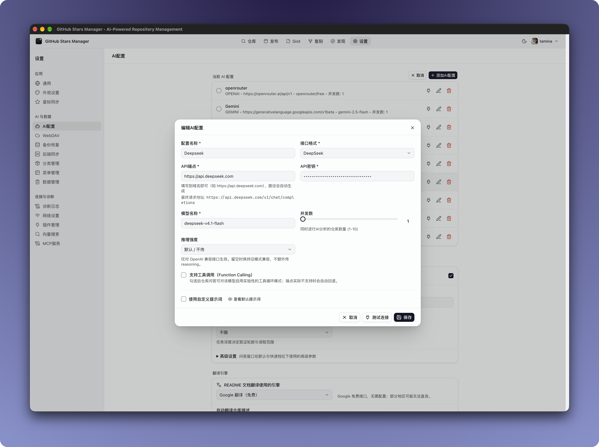<br />
      <b>灵活的多模型 AI 与并发控制</b><br />
      <sub>接入任意主流或本地模型，精细调节并发数（1–10）、推理强度、工具调用、自定义提示词与翻译引擎。</sub>
    </td>
  </tr>
</table>

</details>

---

## 核心能力

<table>
  <tr>
    <td width="50%" valign="top">

**🤖 AI 整理、双语阅读与批量入库**

- **批量 AI 分析**：自动生成摘要、标签、支持平台与分类；支持 1–10 并发、随时暂停/继续，锁定分类永不被 AI 覆盖。
- **双语 README 与描述翻译**：内置近全屏 GitHub 风格 Markdown 阅读器（支持 GFM Alerts、KaTeX 公式、Mermaid 图表、自动目录与多语言 README 切换），提供原文 / 译文 / 双语对照及描述自动翻译。
- **从链接批量 Star**：粘贴文章、Markdown、URL 列表或 JSON，自动提取仓库、预览 README 并一次批量收藏最多 50 个项目（保留最近 10 条账号级历史）。
- **双语 Wiki 跳转**：按仓库语言一键直达 Deepwiki（EN）或 Zread（ZH）。

</td>
    <td width="50%" valign="top">

**🧠 向量语义搜索与相似仓库**

- **Cloudflare Vectorize 语义检索**：将仓库描述或完整 README 嵌入为向量，支持**一键交互式部署向导**（`npm run deploy:vector`）、**增量索引**与**向量维度自动检测**。
- **免重建索引重排序**：支持硅基流动 `BAAI/bge-reranker-v2-m3` 与 LLM 二次重排，切换策略无需重建向量库。
- **查找相似仓库**：在任意卡片一键展开语义邻域，按相似度找出星标中最相近的同类项目。
- **无向量三阶段回退**：未开启向量搜索或服务异常时，自动回退到「查询扩展 + 本地词法召回 + LLM 精选」三阶段检索。

</td>
  </tr>
  <tr>
    <td width="50%" valign="top">

**💬 锚定提交的仓库问答助手**

- **快速路径与证据门槛**：全新问答架构支持 README/文档快速路径、意图自动改写、显式证据校验与 **50 MB 本地快照缓存**。
- **可追溯与多深度控制**：实时流式输出，按需切换任务深度（默认 / 快速 / 深度 / 不限），回答附带可点击的 `file:line` 行级引用徽章，并可检索 Release 更新日志与 Issues。
- **全局问答历史**：按仓库持久化保存对话，支持全局历史抽屉跨仓库搜索与切换会话。

> **能力边界说明**：该功能面向轻量级单仓库只读问答，不会索引整个仓库的全部代码，可能出现检索不完整或无法回答的情况。如需深度全仓代码分析、多文件推理、调试或改代码，请克隆到本地使用成熟的 Coding Agent。

</td>
    <td width="50%" valign="top">

**📡 智能 Release 追踪与远程下载**

- **内置「当前系统」过滤**：自动识别当前设备的操作系统与 CPU 架构（如 `macOS · Apple Silicon`），在时间线中直接高亮推荐安装包。
- **精细化资产规则**：支持自定义关键词规则与黑名单、按规则指定必含/必排仓库、仅展示匹配资产（单卡可一键展开全部）以及「仅显示最新版本」模式。
- **多来源订阅与 AI 总结**：支持星标、Watch 与自定义仓库作为订阅源；展开即可看分页资产、更新日志、源码包与 AI 总结，支持卡片内直下最新 Release 或推送至 **aria2 RPC**。

</td>
  </tr>
  <tr>
    <td width="50%" valign="top">

**🧭 8 频道发现中心与全局代码搜索**

- **8 个内置发现频道**：趋势（含每日榜单历史、连榜天数与 Star 增量）、热门发布、最受欢迎、话题、**X 推文**、**Telegram 频道**、**阮一峰周刊**以及支持 **AI 语义模式**的仓库搜索。
- **自定义外部订阅源**：支持接入最多 10 个外部 RSS / Atom / JSON 信息源，并可自定义隐藏或显示频道。
- **全局代码搜索**：直接在应用内按路径、扩展名与编程语言快速检索 GitHub 公开代码与文档。

</td>
    <td width="50%" valign="top">

**🎨 重塑的工作台、多账号与桌面运维**

- **16 套开发者主题**：内置 Default、Catppuccin、Dracula、Ghostty、GitHub、Gruvbox、Haze、Night Owl、Nord、One Dark Pro、Paper、Pierre、Rosé Pine、Solarized、Tokyo Night、Vitesse；支持跟随系统自动切换并**独立记忆浅/深色预设**，可微调强调色、圆角、字号与减少动效。
- **卡片与导航高度可控**：网格/列表视图自由勾选卡片字段，**拖拽排序和开关仓库卡片快捷操作栏**（含插件按钮），并可自定义顶部导航栏顺序与显隐。
- **多账号无缝切换**：通过存储边界隔离切换多个 GitHub 账号——独立 IndexedDB、认证镜像、按 Profile 隔离的后端 SQLite 与 MCP 端点，以及跨账号 WebDAV / Vectorize 冲突保护。
- **Fork、Gist 与桌面体验**：Fork 上游同步与 Actions 触发、Gist 片段库、开机自启与 10 语言系统托盘、按版本忽略更新提醒、macOS DMG 内置 Gatekeeper 修复工具，以及自动脱敏的全链路诊断日志。

</td>
  </tr>
</table>

<details>
<summary>⚙️ 设置中心一览 — 3 大分组、15 项设置标签（点击展开）</summary>

重构后的设置外壳将 15 项设置清晰划分为三大分组：

| 分组 | 包含设置页 | 核心能力 |
|------|------------|----------|
| **应用**（3 项） | 通用 · 外观设置 · 星标同步 | 10 种界面语言与开机自启/托盘/更新策略、16 套主题与卡片字段/快捷操作栏拖拽排序、GitHub Lists 双向与选择性同步 |
| **AI 与数据**（7 项） | AI配置 · WebDAV · 备份恢复 · 后端同步 · 分类管理 · 菜单管理 · 数据管理 | 多模型并发/推理/翻译引擎、WebDAV 自动备份与历史恢复、自建后端连接与请求路由、分类与锁定规则、顶部导航定制、数据导入导出 |
| **连接与诊断**（5 项） | 诊断日志 · 网络设置 · 插件管理 · 向量搜索 · MCP服务 | 前后端统一日志与脱敏诊断包导出、HTTP/SOCKS5 代理与 aria2 RPC、桌面端插件市场与权限管理、Cloudflare Vectorize 索引、Agent MCP 服务 |

</details>

---

## 桌面端插件生态

Electron 桌面客户端支持从**社区插件注册表**、自定义外部 GitHub 仓库或本地目录安装插件，为星标库扩展更深度的工作流。

- **插件市场与自定义注册表**：按来源浏览与搜索插件，支持一键安装、更新、卸载，可添加外部 GitHub 注册表，并明确标注权限变更、已吊销或已拦截状态。
- **内置精选官方插件**（位于 [`examples/plugins/`](https://github.com/AmintaCCCP/GithubStarsManager/tree/main/examples/plugins)）：
  - **Repo Insights（仓库洞察）**：实时查看仓库健康度评分、52 周提交活跃度、代码变更、贡献者与巴士系数、发布频率、安全公告与六维健康雷达。
  - **Repo Info Card（仓库信息卡）**：AI 一键生成 3 种视觉风格（TE 纸面 / 暗色仪器 / 极简黑白）、多种画幅与 10 种语言的杂志感仓库卡片，支持代码预览与 `@2x` 高清 PNG 导出。
  - **Repo Custom Fields（仓库自定义字段）**：在任意仓库卡片上挂载本地单行文本、安装命令/Markdown 笔记与可点击链接，随查随复制。
  - 同时附带 **Markdown Exporter** 与 **Smart Release Recommender** 等实用示例。
- **网页搜索增强**：可在插件设置中配置 SearXNG 实例，供页面插件执行联网检索。

<table>
  <tr>
    <td width="50%" valign="top">
      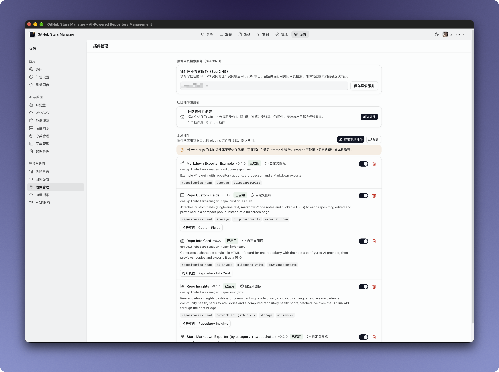<br />
      <b>插件管理与社区注册表</b><br />
      <sub>集中管理本地与社区插件，每项权限（读取仓库、AI 调用、网络域名、剪贴板等）透明展示、按需授权。</sub>
    </td>
    <td width="50%" valign="top">
      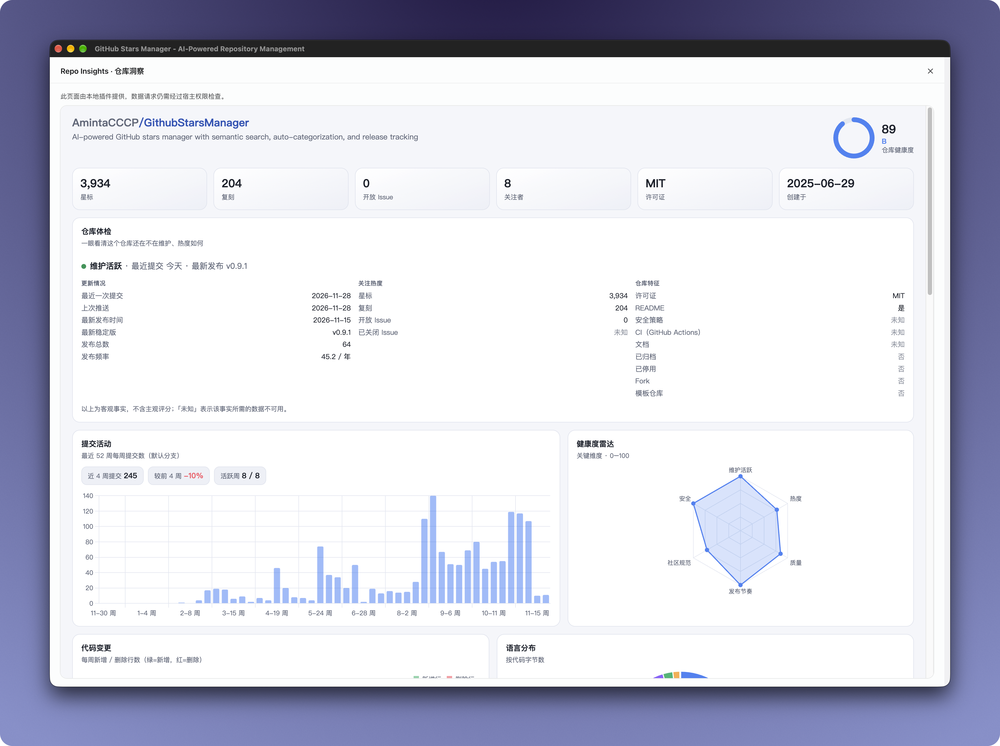<br />
      <b>Repo Insights 仓库洞察</b><br />
      <sub>无需离开应用即可完成项目选型体检：健康评分、提交趋势、发布节奏与社区安全一目了然。</sub>
    </td>
  </tr>
  <tr>
    <td width="50%" valign="top">
      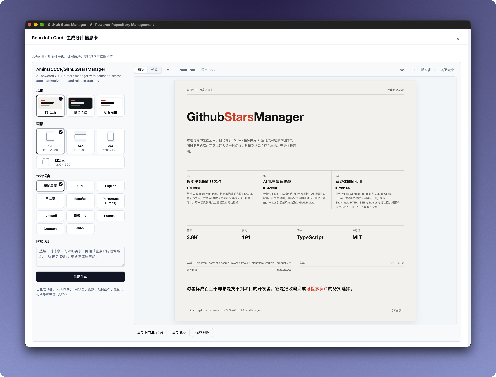<br />
      <b>Repo Info Card 仓库信息卡</b><br />
      <sub>把任意星标项目变成适合分享的编辑级信息卡片，支持切换风格、画幅与 10 种卡片语言。</sub>
    </td>
    <td width="50%" valign="top">
      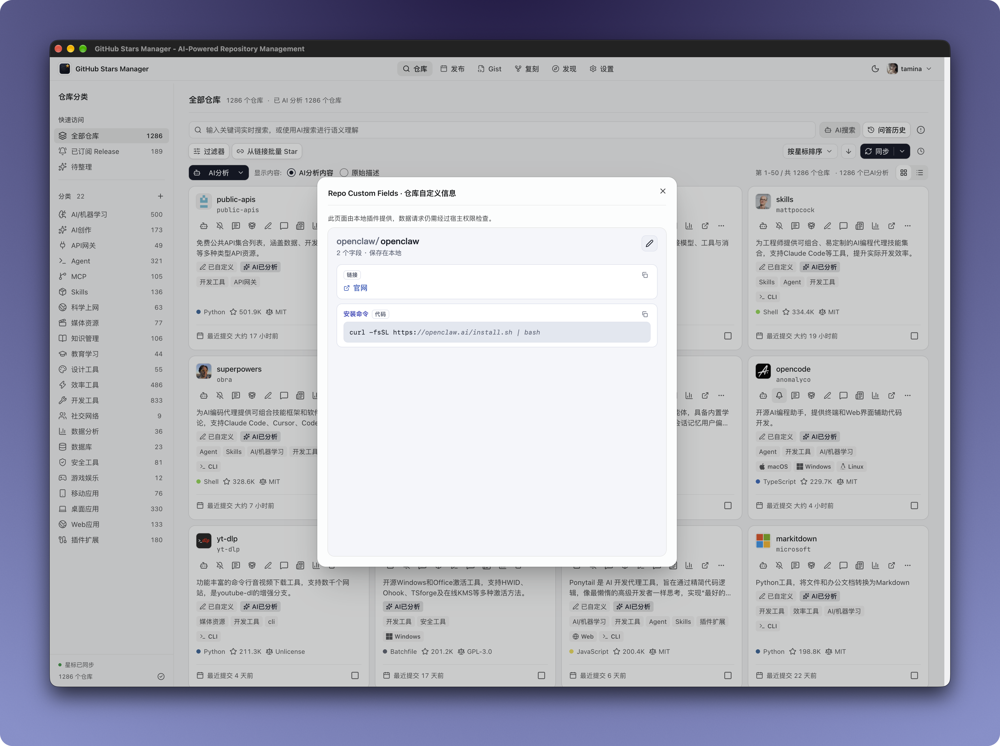<br />
      <b>Repo Custom Fields 自定义字段</b><br />
      <sub>给常用仓库挂上官网、安装命令或踩坑笔记，打开卡片即可一键复制，把星标变成私人工具手册。</sub>
    </td>
  </tr>
</table>

> [!IMPORTANT]
> **插件信任模型与运行环境**：仅 Electron 桌面端提供插件宿主，浏览器和 Docker 前端不包含该功能。插件安装后默认禁用，启用前必须由用户显式确认 Manifest 中声明的权限。Worker 插件运行在隔离的 Node.js 进程中（**并非安全沙箱**，请仅安装受信任的插件）；页面插件运行在受限 iframe 中。

- 📖 [插件使用指南（Wiki）](https://github.com/AmintaCCCP/GithubStarsManager/wiki/Plugin-Usage) — 安装、启用、权限说明与入口位置（在桌面端前往 **设置 → 连接与诊断 → 插件管理**）
- 🛠️ [插件开发文档（Wiki）](https://github.com/AmintaCCCP/GithubStarsManager/wiki/Plugin-Development) · [仓库内开发规范（V1）](docs/plugins/v1-development.md) — Manifest 规范、Worker API、页面 Bridge 与限额
- 📦 示例源码：[`examples/plugins/`](https://github.com/AmintaCCCP/GithubStarsManager/tree/main/examples/plugins)

---

## 快速开始与部署

### 桌面客户端

推荐大多数用户直接下载桌面安装包，开箱即用，天然无浏览器 CORS 限制，并完整包含本地插件、原生 MCP 回环服务与系统托盘能力：

👉 **[前往 GitHub Releases 下载最新版本（macOS / Windows / Linux）](https://github.com/AmintaCCCP/GithubStarsManager/releases)**

- **macOS 提示「已损坏」？** DMG 安装包内置了 **Fix Damaged App** 工具，双击即可自动解除 Gatekeeper 隔离属性。
- **日常常驻体验**：支持开机自启、最小化到 10 语言系统托盘、右键重启应用，以及按版本忽略更新提示。

---

### Docker 自托管部署

GHCR 上提供预构建镜像，无需本地构建：现有 Docker 用户可继续使用完全不变的**前后端分离 Compose 部署**，也可按需选用**全栈单镜像**部署。

#### 方式 A：前后端分离部署（默认方式，适合独立升级与运维）

前端监听 `8080` 端口、后端监听 `3000` 端口，数据持久化在 Docker 卷中。该方式不会因新增全栈镜像而改变；需要独立升级、运维或扩缩容前后端时，推荐继续使用：

```bash
docker pull ghcr.io/amintacccp/github-stars-manager-server:latest
docker pull ghcr.io/amintacccp/github-stars-manager-frontend:latest
docker compose up -d
```

如需自定义密钥或固定镜像版本，在 `.env` 中配置：

```bash
API_SECRET=your-secret
ENCRYPTION_KEY=your-key
BACKEND_IMAGE_TAG=0.9.1   # 固定后端版本（默认：latest）
FRONTEND_IMAGE_TAG=0.9.1  # 固定前端版本（默认：latest）
```

#### 方式 B：可选全栈单镜像（单容器同源）

如果希望只运行一个容器、一个镜像标签和一个数据卷，可使用可选的全栈单镜像 `ghcr.io/amintacccp/github-stars-manager-fullstack`，在同一来源下提供网页、`/api` 与 MCP 端点。请先在仓库根目录 `.env` 中设置足够长的 `API_SECRET`（全栈 Compose 会拒绝在无认证配置下启动）：

```bash
# 在项目根目录的 .env 中设置：
API_SECRET=替换为足够长的随机密钥

docker compose -f docker-compose.fullstack.yml up -d
```

> [!NOTE]
> - 镜像规范名称以角色结尾：`-frontend`、`-backend` 与 `-fullstack`；既有用户使用的 `-server` 后端镜像继续作为兼容别名发布。正式 `vX.Y.Z` 标签与根目录 `package.json` 版本一致，`latest` 与 `sha-*` 用于开发与提交追溯。
> - 如镜像为私有，请先执行 `docker login ghcr.io`（使用带 `read:packages` 权限的 [PAT](https://github.com/settings/tokens)）。
> - 完整的部署细节、数据备份、从分离部署迁移到全栈及回滚指南，请参阅 **[DOCKER_zh.md](DOCKER_zh.md)**（英文版：[DOCKER.md](DOCKER.md)）。

---

### 可选后端服务与安全加固

应用纯前端也可完整运行（数据存于浏览器 `localStorage` / IndexedDB）。接入可选的 Express + SQLite 后端可额外获得：

- **跨设备同步**：在多台设备与浏览器间共享星标、分类、问答历史与配置；新设备登录页可直接选择「已有后端数据」一键恢复。
- **服务端无 CORS 代理**：AI、WebDAV、网络代理与 aria2 RPC 请求经后端转发，避免浏览器跨域限制，支持按设备选择请求路由模式（`auto` / `backend` / `browser`）。
- **加密密钥存储**：GitHub Token、AI Key、WebDAV 与代理密码使用 AES-256-GCM 加密存放于服务端，不暴露在浏览器网络请求中。

<details>
<summary>🐳 仅启动后端容器（docker run）或手动启动源码</summary>

**仅后端（`docker run`）：**

```bash
# 基础运行 — 首次启动自动生成 API Secret 并保存到 /app/data/.api-secret，监听 3000 端口
docker run -d --name github-stars-backend \
  -v github-stars-data:/app/data \
  -p 3000:3000 \
  ghcr.io/amintacccp/github-stars-manager-server:latest

# 显式指定密钥运行
docker run -d --name github-stars-backend \
  -v github-stars-data:/app/data \
  -p 3000:3000 \
  -e API_SECRET="your-secret" \
  -e ENCRYPTION_KEY="your-key" \
  ghcr.io/amintacccp/github-stars-manager-server:latest
```

**手动启动后端：**

```bash
cd server
npm install
npm run dev
```

</details>

#### 安全加固与已有部署升级说明（`API_SECRET`）

> [!WARNING]
> 作为安全加固措施，后端在未设置 `API_SECRET` 时**不再以关闭认证的方式启动**。如果你正在升级一个此前未配置 `API_SECRET` 的旧部署，请按以下步骤获取密钥：

1. **读取自动生成的密钥**：首次启动时后端会生成安全随机密钥并保存到数据卷中的 `data/.api-secret`，**密钥值不会输出到容器日志**。通过以下命令读取：
   - Compose 部署：`docker compose exec backend cat /app/data/.api-secret`
   - 独立容器部署：`docker exec <后端容器> cat /app/data/.api-secret`
   - 也可直接查看宿主机挂载的数据卷文件；若该文件不可用，请在服务端显式配置 `API_SECRET` 环境变量。
2. **在前端完成配对**：在 Web UI（登录页或 **设置 → AI 与数据 → 后端同步**）将密钥填入「API Secret」输入框并测试连接，已有加密数据不受影响。
3. **固定密钥或本地开发**：可在 `.env` 中显式设置 `API_SECRET`（显式配置始终优先）。仅限本地零配置开发时可设置 `ALLOW_INSECURE_NO_AUTH=1`（`npm run dev` 已自动带上，切勿用于公网）。
4. **务必备份加密密钥**：若依赖自动生成的 `data/.encryption-key`，请妥善备份该文件——加密数据与密钥位于同一数据卷，一旦丢失，所有已存储的 GitHub Token、AI Key 与 WebDAV 密码将无法恢复。

#### 后端环境变量

| 变量 | 必填 | 说明 |
|------|------|------|
| `API_SECRET` | 否 | API 认证令牌。未设置时首次启动自动生成随机密钥并写入 `data/.api-secret`，此后所有 `/api` 请求均需携带该 Bearer 令牌。 |
| `ALLOW_INSECURE_NO_AUTH` | 否 | 设为 `1` 或 `true` 可在 `API_SECRET` 未设置时恢复旧版免认证开发模式（服务端会输出醒目警告）。**切勿在公网可达的部署上开启。** |
| `ENCRYPTION_KEY` | 否 | 用于加密存储敏感凭证的 AES-256 密钥。未设置时自动生成并保存到 `data/.encryption-key`。 |
| `PORT` | 否 | 服务监听端口（默认：`3000`）。 |
| `CSP_CONNECT_SRC` | 否 | 追加到 `connect-src` CSP 指令的额外来源（逗号分隔），用于浏览器直连自定义 AI 服务商或向量搜索 Worker（如 `https://ai.example.com,https://worker.example.org`）。 |
| `CSP_UPGRADE_INSECURE_REQUESTS` | 否 | 默认开启，会下发 `upgrade-insecure-requests`。当全栈镜像通过**纯 HTTP**（如 `http://<内网 IP>:3000`）访问时**必须设为 `false`**，否则浏览器会把页面资源改写为 `https://` 导致白屏。仅对不接入 TLS 的 HTTP 部署关闭。 |

#### 前端连接后端步骤

1. 打开应用 **设置 → AI 与数据 → 后端同步**（或首次登录时选择连接已有后端）。
2. 填入后端地址与 **API Secret**（`data/.api-secret` 中生成的密钥，或自定义的 `API_SECRET`）。
3. 点击 **测试连接**，指示灯变绿即表示就绪，随后可通过「同步到后端 / 从后端同步」完成数据互通。

---

### 源码运行与静态托管

```bash
git clone https://github.com/AmintaCCCP/GithubStarsManager.git
cd GithubStarsManager
npm install
npm run dev
```

> [!TIP]
> 本地执行 `npm run dev` 时，纯前端直连 AI 服务或 WebDAV 可能受浏览器 CORS 限制。推荐使用预编译桌面客户端，或同时启动后端服务（`cd server && npm run dev`）代理请求。

执行 `npm run build` 生成的 `dist` 目录可直接托管到任意静态平台（Netlify、Vercel、GitHub Pages、Cloudflare Pages 或自建 Nginx）。

---

## 进阶集成与配置

### 🤖 多模型 AI 服务配置

支持 **OpenAI**、**Anthropic（Claude）**、**Ollama（本地部署）**、**DeepSeek / OpenRouter / Gemini** 及任何兼容 OpenAI 接口的私有端点。

在 **设置 → AI 配置** 中添加服务商后，可独立配置 API 端点、模型、并发数（1–10）、推理强度、工具调用开关、自定义分析提示词以及 README 翻译引擎，并一键测试连通性。

---

### 🧠 向量语义搜索与查找相似仓库

基于 [Cloudflare Vectorize](https://developers.cloudflare.com/vectorize/) 实现自然语言意图检索与相似仓库发现。前端将仓库描述或完整 README 嵌入为向量，通过轻量 Cloudflare Worker 完成存取与查询，支持**增量索引**、**向量维度自动检测**与**免重建索引二次重排序**（硅基流动 `BAAI/bge-reranker-v2-m3` 或 LLM 重排）。

**🌟 一键交互式部署向导（强烈推荐，位于 [`cloudflare-worker/`](cloudflare-worker/README.md)）：**

```bash
# 方式 1：在项目根目录直接运行
npm run deploy:vector

# 方式 2：进入 cloudflare-worker 目录运行对应平台脚本
cd cloudflare-worker
./deploy.sh                  # macOS / Linux（或 node deploy.mjs）
.\deploy.ps1                 # Windows PowerShell（或直接双击 deploy.bat）
npm run deploy:interactive   # 任意平台通过 npm 启动
```

- **免打开 Cloudflare 网页后台**：交互式中文 TUI 逐步引导完成索引检测、密钥注入与 Worker 部署。
- **保留已有索引与数据**：严格复用现有 Vectorize 索引，不重置版本，更新代码**无需重新索引**。
- **本地记忆，一键复部署**：参数安全保存在 `.deploy-config.json`，后续更新直接选择快速重新部署。
- **部署即验**：完成后自动执行连通性检测，直接输出可复制到应用里的 Worker URL 与认证 Token。

完整脚本说明与手动 Wrangler 分步指南请参阅 **[cloudflare-worker/README.md](cloudflare-worker/README.md)**。部署完成后，在 **设置 → 连接与诊断 → 向量搜索** 填入 Worker 地址与认证 Token、选择 Embedding 服务商并点击 **重建索引** 或 **增量索引**即可开启。

<details>
<summary>📊 支持的 Embedding 服务商与模型维度参考</summary>

| 服务商 | 推荐模型 | 维度 |
|--------|----------|------|
| OpenAI | `text-embedding-3-small` / `large` | 1536 / 3072 |
| Gemini | `text-embedding-004` | 768 |
| Cohere | `embed-multilingual-v3.0` | 1024 |
| Ollama（本地） | `nomic-embed-text` / `bge-m3` | 768 / 1024 |
| 硅基流动 | `BAAI/bge-m3` / `BAAI/bge-large-zh-v1.5` | 1024 |
| OpenAI 兼容端点 | 自定义 | 自动检测 / 自定义 |

</details>

> [!WARNING]
> 更换 Embedding 模型后必须执行 **重建索引**——不同模型生成的向量空间与维度互不兼容。

**查找相似仓库**：开启向量搜索后，在任意仓库卡片点击 **查找相似仓库**，应用会结合源仓库画像在向量库中检索最相近的星标（自动排除自身），并在顶部展示锚点横幅，点击重置或切换分类即可返回原视图。

<p align="center">
  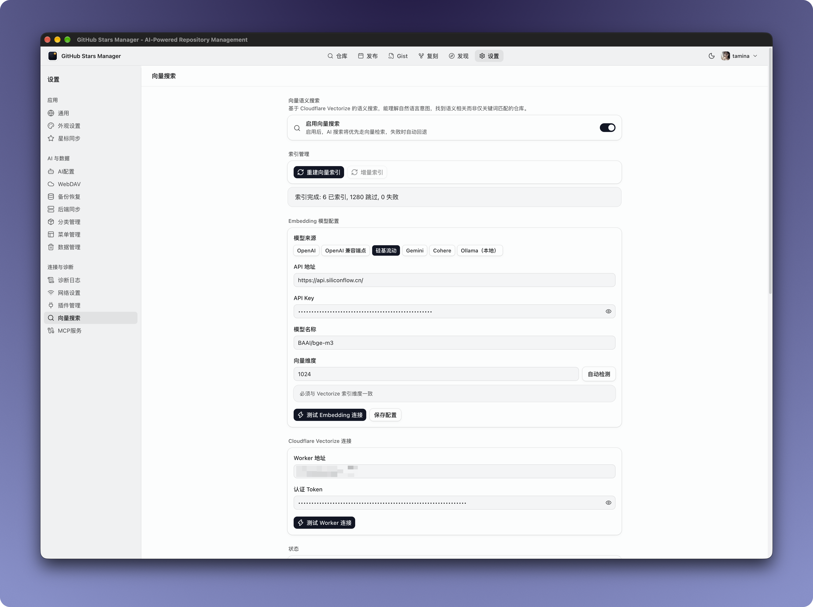
</p>

---

### 🛰️ MCP 服务（供 AI Agent 检索你的星标）

让 Claude Code、Cursor 等支持 [Model Context Protocol](https://modelcontextprotocol.io/) 的 Coding Agent 直接检索你经 AI 整理好的星标知识库，无需额外安装插件或脚本。

- **Streamable HTTP（推荐）**：后端/Docker 同源 `POST /mcp`，或桌面端本地 `http://127.0.0.1:3927/mcp`。
- **旧版 SSE**：后端 `/mcp/sse` + `/mcp/sse/messages`，桌面端 `/sse` + `/messages`。
- **稳定 Bearer 鉴权**：开启时生成固定 Token（`gsm_mcp_...`，与后端 `API_SECRET` 相互独立），重启不变、仅重置时更换；多账号场景可通过 `X-GSM-Profile` 请求头或 `?profile=<id>` 指向指定账号。
- **一键复制配置**：在 **设置 → MCP 服务** 打开开关后，面板直接生成 Streamable HTTP 与 SSE 两套可复制 JSON 配置。

> [!TIP]
> 桌面端 MCP 默认仅绑定本机回环地址 `127.0.0.1`（端口 `3927`，可在设置中调整）。纯前端（无后端）模式不显示 MCP 设置页，需使用桌面客户端或连接自建后端。

<details>
<summary>🧰 全部 10 个只读 MCP 工具与检索边界说明（点击展开）</summary>

| 工具 | 说明 |
|------|------|
| `gsm_status` | 服务状态：仓库数、向量可用性、版本、`availableTools`（当前实际注册工具）与 `conditionalTools`（受向量开关控制的工具） |
| `gsm_search_repos` | 关键词搜索星标，支持按语言 / 标签 / 平台 / 许可证 / 分类 / 星标数筛选与分页 |
| `gsm_get_repo` | 按数字 ID 或 `owner/repo` 获取单个仓库完整信息（含 AI 加工字段） |
| `gsm_get_repos` | 按输入顺序批量获取最多 50 个仓库，保留重复输入并明确报告部分 `not_found` |
| `gsm_get_repo_evidence` | 返回确定性的本地仓库与 Release 缓存证据及 `evidenceFreshness`；未保存字段保持为 `null` |
| `gsm_list_categories` | 列出所有自定义分类 |
| `gsm_list_repos_by_category` | 分页列出指定分类下的仓库 |
| `gsm_stats` | 聚合统计（编程语言分布、AI 分析进度、热门标签） |
| `gsm_find_similar_repos` | 基于向量索引查找相似星标（排除源仓库；仅在向量搜索可用时注册） |
| `gsm_vector_search` | 自然语言语义检索（仅在配置并启用向量搜索时注册） |

**语义与证据说明：**
- `gsm_vector_search` 支持可选的 `languages`、`tags`、`platforms`、`licenses`、`category`、`minStars`、`maxStars`、`isAnalyzed` 与 `isSubscribed` 筛选。传入筛选条件时，Worker 最多返回 50 个语义候选，由应用在本地确定性过滤后再截取 `topK`（并非覆盖全向量语料库的精确 filtered topK）；未传筛选时保持既有行为。
- `gsm_get_repo_evidence` 仅读取本地数据库与 Release 缓存，不发起无界 GitHub API 请求、不推测缺失字段、也不返回采纳结论；其 `evidenceFreshness` 基于已存仓库 `updated_at`、分析时间与缓存 Release `published_at`，本地未记录的同步时间字段固定返回 `null`。

</details>

<p align="center">
  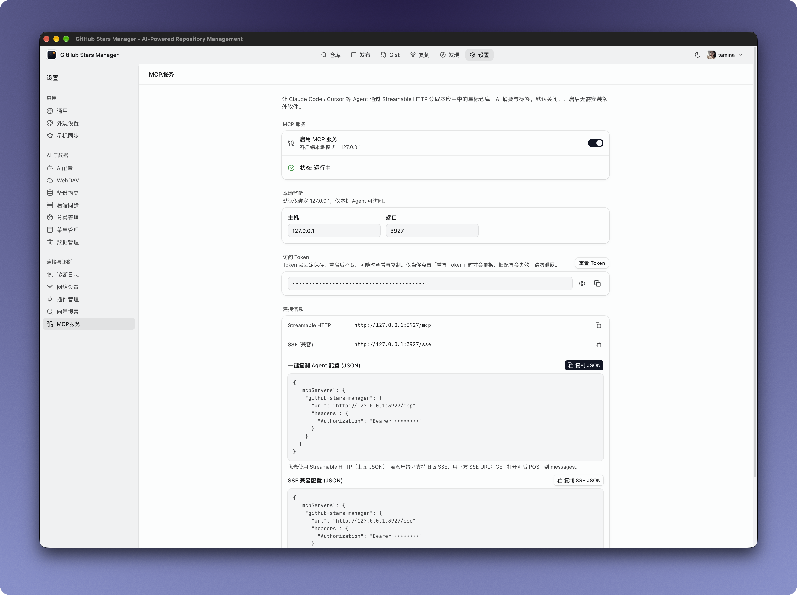
</p>

---

### 🌐 网络代理、远程下载（aria2）与诊断日志

在 **设置 → 网络设置** 中（桌面端或连接后端时可用）可一站式配置出站代理与远程下载：

- **HTTP / SOCKS5 代理**：支持 HTTP CONNECT 隧道与完整 SOCKS5（含 RFC 1929 认证）；连接测试执行真实协议握手而非仅 TCP 探测；代理密码使用 AES-256-GCM 加密存储。
- **远程下载（aria2 RPC）**：启动 `aria2c --enable-rpc --rpc-listen-port=6800` 并在设置中填入主机、端口与可选密钥后，Release 资产按钮即可直接将下载任务推送至 aria2（同时支持后端转发与浏览器直连）。
- **全链路诊断日志**：在 **设置 → 诊断日志** 查看统一的前后端日志，支持 Debug 捕获模式、敏感信息自动脱敏以及一键导出诊断包用于排查问题。

<p align="center">
  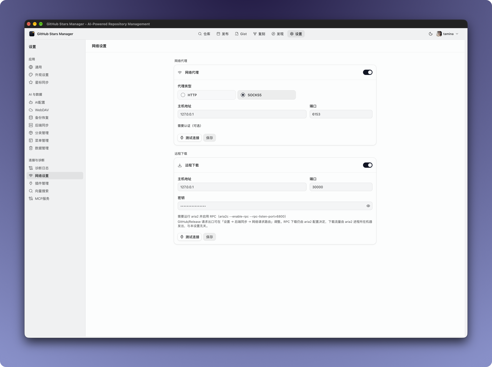
</p>

---

### 🔄 GitHub Lists 双向同步与 WebDAV 备份

- **GitHub Lists 双向同步**：在 **设置 → 星标同步** 中自由切换「仅星标仓库」与「星标仓库及 list」（持久化生效）。拉取时通过 GraphQL 导入原生 [GitHub Lists](https://github.com/features/lists) 为标签/分类并自动锁定；回写时支持**选择性推送指定分类**（内置 32 列表数量与 32 字符名称预校验），同名覆盖、不存在则私有新建，同时保留本地未管理的其他 list 成员关系。
- **WebDAV 自动备份**：支持坚果云、Nextcloud、ownCloud 及任意标准 WebDAV 服务，支持自定义 `User-Agent`、增量/手动备份与历史恢复，并内置多账号跨 Profile 冲突保护。

---

## 界面语言

应用原生支持 **10 种界面语言**：简体中文 · English · 日本語 · Español · Português (Brasil) · Русский · 繁體中文 · Français · Deutsch · 한국어。

- 首次安装自动跟随系统/浏览器语言，也可在登录页右上角或 **设置 → 通用设置** 随时切换。
- **AI 内容与内置分类同步本地化**：仓库摘要与标签、Gist 摘要、Release 更新日志总结及仓库问答回答默认使用当前界面语言输出（自定义提示词完全由用户掌控）；内置分类名称、标签匹配与 GitHub List 改名也会随语言切换自动迁移。
- 缺失词条自动回退英文；翻译持续校对中，欢迎向 [`src/locales`](src/locales) 提交改进 PR。

---

## 技术栈

- **桌面端与前端**：Electron 45 · React 19 · TypeScript · Tailwind CSS 4 · Radix UI（shadcn/ui）· Zustand 5 · Lucide React · Vite 8
- **可选后端**：Express 5 · `better-sqlite3` 13 · SQLite
- **可选云端语义索引**：Cloudflare Workers + Cloudflare Vectorize

---

## 社区、说明与协议

### 适合谁用

- 收藏了数百甚至上千个仓库、总在「我记得 Star 过」里大海捞针的开发者
- 习惯系统追踪开源工具新版本、希望自动筛选本机安装包的效率用户
- 想让 Claude Code / Cursor 直接读懂自己星标库的 AI 工作流玩家

### 补充说明

1. 后端服务为可选项，但在网页端部署时推荐启用。纯前端模式下所有数据保存在本地浏览器存储中，请定期通过 WebDAV 或数据导出做好备份。
2. 作者不会写代码，这个应用完全由 AI 编写，初衷是满足个人需求。如果您有新功能建议或遇到 Bug，我会尽力借助 AI 尝试修复和实现，但无法百分百保证成功。😹

### 参与贡献

欢迎提交 Issue 和 Pull Request！

1. Fork 本仓库
2. 创建功能分支（`git checkout -b feature/AmazingFeature`）
3. 提交更改（`git commit -m 'Add some AmazingFeature'`）
4. 推送分支（`git push origin feature/AmazingFeature`）
5. 开启 Pull Request

### 开源协议与支持

本项目基于 **MIT 许可证** 开源，详见 [LICENSE](LICENSE)。如果 GithubStarsManager 帮您找回了尘封的宝藏仓库，欢迎点一颗 ⭐️ 支持，或在 [Issues](https://github.com/AmintaCCCP/GithubStarsManager/issues) 中反馈建议！

### 星标地图

<a href="https://starmapper.bruniaux.com/AmintaCCCP/GithubStarsManager?utm_source=map-embed&utm_medium=readme&utm_campaign=stargazer-map">
  <picture>
    <source media="(prefers-color-scheme: dark)" srcset="https://starmapper.bruniaux.com/api/map-image/AmintaCCCP/GithubStarsManager?theme=dark" />
    <source media="(prefers-color-scheme: light)" srcset="https://starmapper.bruniaux.com/api/map-image/AmintaCCCP/GithubStarsManager?theme=light" />
    
  </picture>
</a>

### 星标历史

<a href="https://github.com/AmintaCCCP/GithubStarsManager">
  <picture>
    <source
      media="(prefers-color-scheme: dark)"
      srcset="https://starfolio.aminta.top/star-history/githubstarsmanager?theme=dark"
    />
    <source
      media="(prefers-color-scheme: light)"
      srcset="https://starfolio.aminta.top/star-history/githubstarsmanager?theme=light"
    />
    
  </picture>
</a>
