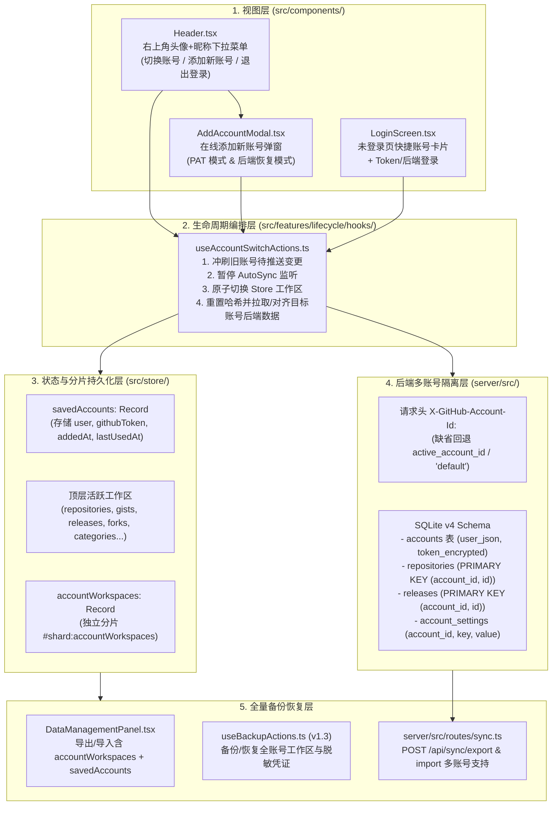

# 多账号切换与全链路数据隔离实施方案（Issue #611）

- **日期**：2026-11-16
- **关联 Issue**：[#611 — [Feature] support multi github accounts](https://github.com/AmintaCCCP/GithubStarsManager/issues/611)
- **适用执行方**：Coding Agent（可直接按本方案逐步实施并完成自测与门禁校验）
- **核心红线**：
  1. **切换账号严禁造成任何数据丢失或串号污染**（涵盖纯客户端、连接后端 Server、以及本地文件 / WebDAV / 后端导入导出全场景）。
  2. **遵守前端分层架构守则（ADR 0001 & `scripts/check-boundaries.cjs`）**：视图组件（`src/components/**`）严禁直接 import `services/*`（如 `githubApiFactory`、`autoSync`、`backendAdapter`），所有跨层编排逻辑必须置于 `src/features/lifecycle/hooks/`。
  3. **遵守持久化分片与测试契约**：新增持久化字段必须同步注册到 `src/store/persistence/shards.ts`、`src/store/schema.ts`、`src/store/persistence/options.ts` 与 `src/store/useAppStore.modularization.test.ts`。
  4. **遵守 i18n 门禁（`scripts/check-i18n.cjs`）**：10 种语言（`zh`, `en`, `ja`, `es`, `pt-BR`, `ru`, `zh-TW`, `fr`, `de`, `ko`）键集合严格对齐，非中英语言提供真实翻译，JSX 与 UI 属性严禁硬编码文案。

---

## 一、现状诊断与数据丢失风险根因分析

通过全仓代码走查，当前系统已有 `accountWorkspaces: Record<string, AccountWorkspace>`（见 `src/store/helpers/accountWorkspace.ts`），但仅完成了「单账号登出时暂存快照、再次登录同账号时恢复」的半程能力。若直接在此基础上做多账号切换，存在 **5 个会导致数据丢失或串号的高危漏洞**：

| 序号 | 场景分类 | 现状代码位置 | 数据丢失 / 污染根因 |
| :--- | :--- | :--- | :--- |
| **R1** | **客户端凭证与账号列表缺失** | `src/store/persistence/authStorage.ts`、`src/store/slices/authSlice.ts` | 仅持久化当前活跃的单个 `user` + `githubToken`。切换或退出后旧账号的 `GitHubUser` 信息（头像、昵称、login）与 `githubToken` 被覆盖，无法在下拉菜单列出已保存账号并一键切换。 |
| **R2** | **恢复后端数据时旧账号内存被新数据覆盖后快照** | `src/components/LoginScreen.tsx:251-260`、`src/store/helpers/accountWorkspace.ts:263` | 先调用 `syncBackendData()` 将新账号的后端数据写入顶层 `state.repositories`，随后才调用 `setUser(newUser)`。在 `switchAccountWorkspace` 中会把**已被新账号污染的顶层状态**作为 `previousAccountId` 的快照写入 `accountWorkspaces[prevId]`，导致旧账号本地数据被彻底覆盖！**注**：现网 LoginScreen 仅在 `!isAuthenticated` 时渲染（`src/App.tsx:350`），此时 `user` 恒为 null、`previousAccountId` 为 null，`accountWorkspace.ts:263` 的空保护已覆盖纯登录场景；该漏洞的**真实可达路径**是「持久化了 user 但 token 丢失」的边缘态，以及本方案新增的 **AddAccountModal 后端恢复模式**（已在登录态下拉取另一后端账号数据）。因此 `parkCurrentAccountForRestore()` 属于预防性修复，且 **AddAccountModal 后端恢复模式在拉取后端数据前必须调用 `parkCurrentAccountForRestore()`**。 |
| **R3** | **客户端在途异步任务跨账号写穿（In-Flight Write-Through）** | `autoSync.ts`（2s debounce / 5s poll）、Star 同步、AI 批量分析、Release/Fork 刷新 | 账号 A 发起同步或分析（或有未落盘的 2s 防抖推送）时切到账号 B，异步 Promise 完成后直接调用 `store.setRepositories` / `updateRepository`，把账号 A 的数据写进账号 B 的活跃工作区，或把账号 B 的工作区推送到账号 A 的后端。 |
| **R4** | **后端 SQLite 全局单表无 `account_id` 隔离（致命清空）** | `server/src/db/schema.ts`、`server/src/routes/repositories.ts:222-236`、`autoSync.ts:755` | 后端 `repositories`、`releases`、`settings` 全是单租户全局表。客户端从账号 A（500 仓）切到账号 B（0 仓或 50 仓）时，`useAppStore.subscribe` 检测到 `state.repositories` 引用变化，2 秒后触发 `PUT /api/repositories { isFullSync: true }`，后端执行 `DELETE FROM repositories WHERE id NOT IN (...)`，**瞬间物理清空账号 A 在后端数据库中的全部仓库、AI 总结、自定义分类与 Release！** 同时 `/api/proxy/github/*` 始终读取单一 `settings.github_token`，导致切号后代理请求仍用旧账号 Token。 |
| **R5** | **备份与恢复（本地 JSON / WebDAV / 后端导出）漏备其他工作区或恢复错位** | `src/components/settings/DataManagementPanel.tsx:633-1162`、`src/features/settings/hooks/useBackupActions.ts:64-276`、`server/src/routes/sync.ts` | 1) 本地导出与 WebDAV 备份只导出了当前活跃账号的 `repositories`/`releases`，**完全丢弃了 `accountWorkspaces` 中其他已保存账号的数据及 `savedAccounts`**；<br>2) 恢复数据时未合并 `accountWorkspaces`，若在账号 B 下恢复或导入，会导致其他账号工作区丢失或跨账号张冠李戴。 |

---

## 二、总体架构设计



---

## 三、分模块详细实施规范

### 模块 1：客户端数据模型与状态存储（`src/types/` & `src/store/`）

#### 1.1 类型定义扩展（`src/types/index.ts`）
在 `AccountWorkspace` 定义旁新增 `SavedAccount` 接口，并扩展 `AppState`：

```ts
export interface SavedAccount {
  /** GitHub 数值 ID 字符串，与 accountIdKey(user) 一致 */
  accountId: string;
  user: GitHubUser;
  /** 该账号的 GitHub PAT；仅当用户主动移除账号或未包含密钥导入时为空字符串 */
  githubToken: string;
  addedAt: string;
  lastUsedAt: string;
}
```
在 `AppState` 的 `// Auth` 区域新增：
```ts
  savedAccounts: Record<string, SavedAccount>;
```

#### 1.2 Store Actions 扩展（`src/store/types.ts` & `src/store/slices/authSlice.ts`）
在 `AppActions` 中扩展认证与多账号动作：
```ts
  // Auth & Multi-account actions
  setUser: (user: GitHubUser | null) => void;
  setGitHubToken: (token: string | null) => void;
  logout: () => void;
  /** 保存或更新某个账号的凭证与用户信息到 savedAccounts */
  upsertSavedAccount: (user: GitHubUser, githubToken: string) => void;
  /** 在已保存账号间原子切换（快照当前账号工作区 -> 恢复目标账号工作区与凭证） */
  switchAccount: (accountId: string) => boolean;
  /** 从已保存账号列表中移除指定账号（保留或可选清理其 accountWorkspaces，若移除的是当前账号则自动切到下一个账号或登出） */
  removeSavedAccount: (accountId: string) => void;
  /** 在执行外部数据恢复（如后端恢复）前，预先将当前已登录账号的工作区安全归档并清空顶层工作区，防止 R2 污染 */
  parkCurrentAccountForRestore: () => string | null;
```

#### 1.3 `accountWorkspace.ts` 与 `authSlice.ts` 核心逻辑（`src/store/helpers/accountWorkspace.ts`）
1. 在 `accountWorkspace.ts` 中新增 `normalizeSavedAccounts(value: unknown): Record<string, SavedAccount>`：
   - 校验每项包含合法的 `user`（`id` 为正整数、`login` 为非空字符串、`avatar_url` 为字符串）与 `githubToken`（字符串）。
   - 保持引用稳定：若规整化前后内容一致，避免无意义重建。
2. **修复 R2（防止已登录时添加新账号/恢复后端数据冲掉当前账号数据）**：
   - 新增 `parkCurrentAccountWorkspace(current)` 辅助函数：当用户处于已登录态（`previousAccountId !== null`）准备拉取新账号的后端数据前，先把当前顶层数据快照写入 `accountWorkspaces[previousAccountId]`，并将顶层工作区重置为 `applyAccountWorkspace(accountWorkspaces[targetAccountId])`。
3. **完善 `createAuthSlice`（`src/store/slices/authSlice.ts`）**：
   - `setUser(user)`：
     - 当 `user` 非空且当前 `get().githubToken` 非空时，自动将 `{ accountId, user, githubToken, addedAt, lastUsedAt: now }` 合并写入 `savedAccounts[accountId]`，确保**无论是首次登录、重新登录还是测试代码调用 `setGitHubToken` + `setUser`，当前账号都会自动进入 `savedAccounts`**。
   - `setGitHubToken(token)`：
     - 若当前已有 `user` 且 `token` 非空，同步更新 `savedAccounts[accountId].githubToken = token`。
     - `switchAccount(targetAccountId)`：
     - 从 `get().savedAccounts[targetAccountId]` 读取目标账号 `{ user: nextUser, githubToken: nextToken }`；若不存在或无有效 `githubToken` 则返回 `false`。
     - 若 `accountIdKey(current.user) === targetAccountId`，仅更新 `lastUsedAt` 并返回 `true`。
     - 调用 `switchAccountWorkspace(current, previousAccountId, targetAccountId)`：将当前账号完整状态快照进 `accountWorkspaces[previousAccountId]`，同时取出 `accountWorkspaces[targetAccountId]`（若无则为空工作区）应用到顶层。
     - **注意**：不要在 `switchAccountWorkspace` helper 内部向返回的 `accountWorkspaces` 字典写入 `targetAccountId` 条目——`src/store/helpers/accountWorkspace.test.ts:126/148` 断言 `expect(result.accountWorkspaces).toEqual({})`（精确相等），helper 必须对现有测试 100% 兼容。导出/备份所需的「目标账号快照」一律在导出时刻用 `captureAccountWorkspace(store)` 即时合成（见模块 5，不要在切换时预存副本，避免双份驻留且即刻过期）。
     - 置 `isAuthenticated: true`（`src/App.tsx:350` 依赖该显式字段渲染主界面；从 LoginScreen 一键恢复会话时若缺失此字段会卡死在登录页）。
     - 重置会话级瞬态 UI 状态，防止旧账号视图状态残留：
       - `selectedCategory: 'all'`
       - `currentView` 重置为默认视图
       - `searchFilters: { ...initialSearchFilters, sortBy: current.searchFilters.sortBy, sortOrder: current.searchFilters.sortOrder }`
       - `gistSearchFilters: { ...initialGistSearchFilters, sortBy: current.gistSearchFilters.sortBy, sortOrder: current.gistSearchFilters.sortOrder }`
       - `releaseExpandedRepositories: new Set<number>()`
       - `forkExpandedRepositories: new Set<number>()`
       - `releaseSelectedFilters` / `releaseSearchQuery` / `forkSelectedFilters` / `forkSearchQuery`：重置为初始值（防止持久化过滤残留跨账号可见）
       - `analysisProgress` / `vectorIndexingState`：清空（防止新账号显示旧账号「分析中/索引中」残留）
       - `similarView: null`
       - `readmeModalOpen: false`
     - 调用 `resetSyncHashes()`，并调用 `writeAuthMirror({ user: nextUser, githubToken: nextToken, backendApiSecret: current.backendApiSecret })`。
   - `logout()`：
     - **严格保持现有单元测试契约**（见 `src/store/useAppStore.test.ts:975-1030`）：
       - 将当前账号工作区快照存入 `accountWorkspaces[accountId]`；
       - 清空 `AUTH_MIRROR_KEY` 与 `sessionStorage` 中的 `backendApiSecret`；
       - 调用 `resetSyncHashes()`；
       - 置 `user: null, githubToken: null, backendApiSecret: null, isAuthenticated: false`，并将顶层工作区重置为 `applyAccountWorkspace(undefined)`。
       - **注意**：`logout()` 保留 `savedAccounts` 中的历史账号记录（但用户停留在 `LoginScreen` 直到选择账号或输入新 Token），这样用户在登录页仍能看到已保存账号卡片一键重新进入，或者在下拉菜单中直接点击「切换账号」而无需走「退出登录」。

#### 1.4 持久化分片与版本迁移（`v17` → `v18`）
1. `src/store/initialState.ts`：初始状态加入 `savedAccounts: {}`。
2. `src/store/schema.ts`：`PersistedAppState` Pick 列表加入 `'savedAccounts'`。
3. `src/store/persistence/shards.ts`：
   - 在 `PERSISTENCE_SHARD_FIELDS.core` 数组中添加 `'savedAccounts'`（`savedAccounts` 仅含用户基础信息与 Token，体积极小，归入 `core` 分片按内容判脏）。
4. `src/store/persistence/options.ts`：
   - `version` 从 `17` 递增为 `18`。
   - `partialize` 增加 `savedAccounts: state.savedAccounts`（`state.savedAccounts` 是唯一来源，全仓不存在 `accountSavedAccounts` 属性，切勿杜撰）。
   - `migrate` 增加 `v17 → v18` 迁移逻辑：
     ```ts
     // v17→v18: 初始化 savedAccounts，并将当前已登录账号自动回填进 savedAccounts
     if (state) {
       const stateRecord = state as Record<string, unknown>;
       const normalizedSaved = normalizeSavedAccounts(stateRecord.savedAccounts);
       const existingUser = stateRecord.user as GitHubUser | null | undefined;
       const existingToken = stateRecord.githubToken as string | null | undefined;
       const uid = accountIdKey(existingUser);
       if (uid && existingUser && typeof existingToken === 'string' && existingToken) {
         const now = new Date().toISOString();
         normalizedSaved[uid] = {
           accountId: uid,
           user: existingUser,
           githubToken: existingToken,
           addedAt: normalizedSaved[uid]?.addedAt ?? now,
           lastUsedAt: now,
         };
       }
       stateRecord.savedAccounts = normalizedSaved;
     }
     ```
5. `src/store/normalizers/persistedState.ts`：
   - 在 `normalizePersistedState` 中规整化 `savedAccounts: normalizeSavedAccounts(...)`，若 `resolvedUser && resolvedGithubToken` 存在，同样确保 `resolvedUser` 被同步登记在返回状态的 `savedAccounts` 中。
6. `src/store/useAppStore.modularization.test.ts`：
   - 在 `currentPersistedKeys` 数组中加入 `'savedAccounts'`，并更新版本号断言（如有）。

---

### 模块 2：右上角头像下拉菜单与添加账号交互（`src/components/` & `src/features/lifecycle/`）

#### 2.1 交互设计要求（对齐用户需求与 Issue #611）
1. **将右上角头像旁的独立退出按钮改为下拉菜单**：
   - 在 `src/components/Header.tsx` 中，将原本独立的头像展示 + `<LogOut />` 按钮整合为一个统一的交互触发器（`DropdownMenuTrigger`）：
     - 触发器包含：用户头像（`w-7 h-7 rounded-full`）、用户名（`hidden sm:block`，显示 `user.name || user.login`）、以及右侧下拉箭头图标 `<ChevronDown className="h-4 w-4 text-muted-foreground" />`。
   - 点击触发器展开 `DropdownMenuContent`（`align="end" className="w-64"`），内部结构如下：
     1. **当前账号头部 / 切换账号分组标题**：
        - `DropdownMenuLabel`：`t('header.switch-account')`（切换账号）。
     2. **已保存账号列表（`savedAccounts`）**：
        - 按 `lastUsedAt` 倒序（当前活跃账号置顶）列出所有已保存账号（若只有当前 1 个账号，也展示当前账号项并标记「当前使用」勾选图标 `<Check className="h-4 w-4 text-primary" />`）。
        - 每行显示：
          - 头像 ``
          - 双行文本：主行 `acc.user.name || acc.user.login`（`font-medium truncate`），副行 `@${acc.user.login}` 及该账号缓存仓库数徽标（如 `repositories.length`）
          - 右侧状态：当前活跃账号显示 `<Check />`；非活跃账号右侧可提供一个轻量的移除按钮（`<Trash2 />` 或 `<X />`，点击并二次确认后调用 `removeSavedAccount(acc.accountId)` 移除该保存的账号凭证，但不删除其他账号数据）。
        - 点击非活跃账号项：触发 `handleSwitchAccount(acc.accountId)`，无缝切换到该账号！若该账号因导入脱敏备份导致 `githubToken` 为空，则自动弹出 `AddAccountModal` 并预填该账号提示补全 Token。
     3. **分隔线 `DropdownMenuSeparator`**
     4. **添加新账号（`DropdownMenuItem`）**：
        - 图标：`<UserPlus className="mr-2 h-4 w-4" />`
        - 文案：`t('header.add-account')`（添加新账号）
        - 行为：打开 `AddAccountModal` 弹窗（**不触发当前账号登出**！用户若在弹窗中点击取消或关闭，当前账号工作区与会话毫发无损）。
     5. **分隔线 `DropdownMenuSeparator`**
     6. **退出登录（`DropdownMenuItem`）**：
        - 图标：`<LogOut className="mr-2 h-4 w-4" />`
        - 文案：`t('header.logout')`（退出登录）
        - 样式：`text-destructive focus:text-destructive`
        - 行为：保持现有二次确认弹窗 `confirm(t('header.logout-confirmation'), t('header.logout-only-clears-credentials-repositories-ai-a'), { type: 'warning' })`，确认后调用 `handleLogout()`。

#### 2.2 新增 `AddAccountModal.tsx`（`src/components/AddAccountModal.tsx`）
- 为什么使用独立 Modal 而不是直接跳回 `LoginScreen`？
  - 如果直接调 `logout()` 跳回 `LoginScreen`，用户一旦反悔想取消添加，由于凭证已被清空，就回不到原账号了。
  - 使用 `AddAccountModal`（基于 `src/components/ui/dialog.tsx`）：
    - 支持两种添加方式（与 `LoginScreen` 一致，复用 `useAccountSwitchActions`）：
      1. **GitHub Personal Access Token 模式**（默认）：输入新账号的 `ghp_...` Token，直连校验 `authenticateWithGitHub(token)`：
         - 校验成功后，若该 GitHub ID 已是当前活跃账号，仅更新 Token 并提示；
         - 若是新账号或已保存的另一账号，调用 `addOrSwitchWithToken(user, token)`：安全归档当前账号 -> 切换到新账号工作区 -> 若连接了后端则将该账号及 Token 同步至后端该账号分区并拉取该账号在后端的数据。
      2. **从后端恢复账号模式**：输入/确认 Backend URL 与 API Secret，拉取后端已绑定的账号列表或 Token，选择并恢复。**该模式在拉取后端数据写入 Store 前，必须先调用 `parkCurrentAccountForRestore()` 将当前已登录账号的工作区安全归档并清空顶层工作区**，防止 R2 污染。
- 同时增强 `src/components/LoginScreen.tsx`：
  - 当用户处于未登录界面（例如刚点击了「退出登录」）且 `Object.keys(savedAccounts).length > 0` 时，在 `LoginScreen` 登录卡片上方展示「已保存的账号（Saved Accounts）」快捷列表（显示头像、名称、`@login`、缓存仓库数）：
    - 若该账号保存有有效 Token，点击即可一键恢复会话（并在连接后端时对齐后端数据）；
    - 若 Token 已失效或为空，点击则聚焦到 Token 输入框重新授权。

#### 2.3 账号切换与并发防护 Hook（`src/features/lifecycle/hooks/useAccountSwitchActions.ts`）
遵循 `scripts/check-boundaries.cjs`，新建 `src/features/lifecycle/hooks/useAccountSwitchActions.ts`，封装所有涉及 `services/autoSync`、`services/backendAdapter`、`services/githubApiFactory` 的切换编排：

```ts
export interface AccountSwitchActions {
  isSwitching: boolean;
  switchToAccount: (targetAccountId: string) => Promise<{ ok: boolean; needsToken?: boolean; error?: string }>;
  addAccountWithToken: (token: string) => Promise<{ ok: boolean; user?: GitHubUser; error?: string }>;
  removeAccount: (targetAccountId: string) => Promise<void>;
  logoutCurrentAccount: () => Promise<void>;
}
```

**`switchToAccount(targetAccountId)` 的零数据丢失标准执行序列**：
1. **前置守卫**：读取 `current = useAppStore.getState()`，若 `accountIdKey(current.user) === targetAccountId` 直接返回 `{ ok: true }`。
2. **检查目标凭证**：读取 `target = current.savedAccounts[targetAccountId]`，若不存在或 `!target.githubToken.trim()`，返回 `{ ok: false, needsToken: true }`（由 UI 打开 `AddAccountModal` 补填 Token）。
3. **冲刷并冻结旧账号在途同步（解决 R3 & R4）**：
   - 调用 `autoSync.ts` 新增的 `prepareForAccountSwitch(previousAccountId)`：
     - 若存在未触发的 `_debounceTimer` 或 `_hasPendingLocalChanges`，**立即在旧账号上下文（`X-GitHub-Account-Id: previousAccountId`）下执行 `syncToBackend()`**，确保旧账号最后 2 秒内的本地修改 100% 落入后端旧账号分区。
     - **冲刷必须排空推送通道**：注意 `waitForInFlightSync()`（`autoSync.ts:51-59`）只等待拉取 `_syncPromise`，**不等待推送 `_pushPromise`**。`prepareForAccountSwitch` 必须循环 `await syncToBackend()` 直至 `_hasPendingLocalChanges === false` 且 `_pushPromise` 为 null（带上限重试，如 3 次；若后端瞬时不可达导致冲刷失败，记录告警但不阻塞切换——推送内容与请求头原子一致，旧账号的未决修改将在下次进入账号 A 会话时补推，绝不能把失败标记带入新账号会话）。
     - 等待任何在途的 `waitForInFlightSync()` 结束。
     - 开启切换静默锁 `_isSwitchingAccount = true`，阻止 Store 订阅器把接下来的工作区切换误判为本地编辑推送（即 `withAccountSwitchGuard(fn)` 包裹第 4-6 步；该守卫由 `useAccountSwitchActions.switchToAccount` 调用，不是孤立 API）。
     - 切换完成后（第 6 步）显式清零 `_hasPendingLocalChanges` / `_hasPendingPush` 等模块级标志，避免语义残留。
4. **原子切换客户端 Store 工作区**：
   - 调用 `useAppStore.getState().switchAccount(targetAccountId)`（内部完成旧工作区快照写入 `accountWorkspaces[previousAccountId]`、加载 `accountWorkspaces[targetAccountId]`、更新 `user` 与 `githubToken`、重置 `_lastHash`）。
5. **对齐后端目标账号分区（若 `backend.isAvailable` 为 `true`）**：
   - 调用 `backend.syncSettings({ github_token: target.githubToken, active_account_id: targetAccountId, user_profile: target.user })`（此时请求头已自动携带新的 `X-GitHub-Account-Id: targetAccountId`）。**必须携带 `user_profile`**：后端 `accounts.user_json` 表唯一的写入路径就是 `PUT /api/settings` 的 `user_profile` 字段（`autoSync.ts:650-661` 现有推送载荷不含 user 字段，若不主动发送则后端恢复的账号列表永远没有头像/昵称，LoginScreen 快捷卡片无法渲染）。登录流程（`useLoginActions` / AddAccountModal）首次上传 Token 时同样附带 `user_profile`。
   - 调用 `syncFromBackend({ force: false })`：
     - 若后端该账号分区已有数据，拉取并合并到本地；
     - 若后端该账号分区为空而本地该账号工作区有数据，`autoSync` 的空保护逻辑会自动将本地该账号数据推送到后端 `targetAccountId` 分区。
6. **释放切换锁并刷新桌面端桥接**：
   - 置 `_isSwitchingAccount = false`，调用 `refreshMcpElectronBridge()`。

---

### 模块 3：客户端在途异步任务跨账号串号防护（解决 R3）

当用户在拉取 Star、AI 批量分析、刷新 Release/Fork 时突然切换账号，必须防止旧账号的异步回调污染新账号的活跃状态。**采用「Store 写入口统一防护（主防线）+ 长任务钩子显式校验（辅助防线）」双层设计**——只靠逐个 hook 加校验必然遗漏（全仓长时异步写者众多），因此主防线放在 Store 写入口：

1. **Store 层会话代次 / 账号校验保护（主防线，写入口统一拦截）**：
   - 在 `src/store/helpers/accountWorkspace.ts` 中提供轻量辅助函数：
     ```ts
     export const isCurrentAccount = (expectedAccountId: string | null): boolean =>
       accountIdKey(useAppStore.getState().user) === expectedAccountId;
     ```
   - **在 Store 各写 action 内部统一做「写时账号校验」**：对 `setRepositories`、`updateRepository`、`updateRepositoriesMetadata`、`addRepository`、`setGists`、`updateGist`、`setStarredGists`、`setReleases`、`setForks`、`setCategories` 等会批量覆盖/追加工作区数据的 action，在其实现中记录「本次写入发起时的账号上下文」语义：由于切换是同步 `set()`，无法事后区分写入者，因此采用**调用方显式传递代次**的方式成本过高，改为在这些 action 的**所有异步批量调用点**（下述清单）传入 `expectedAccountId` 并在写入前校验 `isCurrentAccount(expectedAccountId)`，不一致时丢弃或归档至 `accountWorkspaces[expectedAccountId]`。
   - **必须覆盖的异步批量写路径完整清单**（审计确认，逐一接入校验）：
     - `src/features/repositories/hooks/useRepositoryAnalysisJob.ts`（AI 批量分析，`updateRepository` 逐条回写）
     - `src/features/repositories/hooks/useBatchStarImport.ts`（批量导入，`addRepository` 逐条写入，耗时可达分钟级）
     - `src/features/repositories/hooks/useBatchStarHistory.ts`
     - `src/features/repositories/hooks/useBulkRepositoryActions.ts`（`updateRepository` 批量快捷操作）
     - `src/features/repositories/hooks/useRepositoryCardActions.ts`（卡片快捷操作回写）
     - `src/features/settings/hooks/useVectorSearchActions.ts`（`updateRepositoriesMetadata` 周期性打 `vector_indexed_at` 戳）
     - `src/features/gists/hooks/useGistActions.ts`（Gist AI 分析与编辑回写 `updateGist`）
     - `src/features/releases/hooks/useReleaseTimelineActions.ts`
     - `src/features/releases/hooks/useWatchedSourcesSync.ts`
     - Star / Gist / Release / Fork 全量刷新流（`useLoginActions`、`useBackendLifecycle` 中的 `syncGitHubData` 等）
2. **长任务显式校验（辅助防线）**：
   - **`src/features/repositories/hooks/useRepositoryAnalysisJob.ts`（AI 批量分析）**：
     - 任务启动时记录 `const jobAccountId = accountIdKey(useAppStore.getState().user)`；
     - 每个仓库分析完成准备调用 `updateRepository(updatedRepo)` 前，检查 `isCurrentAccount(jobAccountId)`：
       - 若仍为当前账号，正常调用 `updateRepository(updatedRepo)`；
       - 若用户已切换到其他账号，要么中止后续分析队列，要么将已完成的那条分析结果写入 `accountWorkspaces[jobAccountId].repositories` 对应项中，**绝不写入当前活跃账号的 `state.repositories`**！
   - **Star / Gist / Release / Fork 刷新流**：
     - 在发起全量拉取前记录 `const startedAccountId = accountIdKey(useAppStore.getState().user)`；
     - 异步请求返回、准备调用 `setRepositories` / `setGists` / `setStarredGists` / `setReleases` / `setForks` 时，校验 `accountIdKey(useAppStore.getState().user) === startedAccountId`。若不一致（说明期间发生了切号或登出），直接丢弃或归档至 `accountWorkspaces[startedAccountId]`，不覆盖新账号的顶层列表。
   - **向量搜索跨账号可见性防护**：向量索引内容按 repo `id`/`full_name` 写入共享 worker（`vector_search_configs` 为实例共享配置），账号 B 的语义搜索可能命中只有账号 A 星标过的仓库。**语义搜索结果必须按当前活跃账号 `state.repositories` 的 id 集合过滤后再展示/写入**（在 `useVectorSearchActions` 的搜索结果处理处过滤），杜绝跨账号数据外泄。

---

### 模块 4：后端多账号数据隔离方案（`server/` & `src/services/backendAdapter.ts` & `autoSync.ts`）

这是保障「有后端情况下切换账号绝不丢失数据」的核心改造。

#### 4.1 通信协议扩展：请求头 `X-GitHub-Account-Id`
1. **CORS 白名单放行（`server/src/index.ts`）**：
   - 在 `cors({ allowedHeaders: [...] })` 中加入 `'X-GitHub-Account-Id'` 与 `'x-github-account-id'`。
2. **前端请求头自动注入（`src/services/backendAdapter.ts`）**：
   - 在 `getBackendAuthHeaders(explicitAccountId?: string | null)` 中：
     ```ts
     const accountId = explicitAccountId !== undefined
       ? explicitAccountId
       : accountIdKey(useAppStore.getState().user);
     if (accountId) {
       headers['X-GitHub-Account-Id'] = accountId;
     }
     ```
   - 这样 `backendAdapter` 的所有方法（`fetchRepositories`, `syncRepositories`, `fetchReleases`, `syncReleases`, `fetchSettings`, `syncSettings`, `/proxy/github/*` 等）会自动携带当前账号的 `X-GitHub-Account-Id`！
   - **注**：`src/services/telegramService.ts:112`、`src/services/xTweetService.ts:122/219` 等直接调用 `getBackendAuthHeaders` 的服务也会自动携带该请求头（后端按账号隔离其数据分区属正确行为，无害，实现时无需特殊处理但应在 PR 描述中注明）。

#### 4.2 后端 SQLite Schema 迁移 v4（`server/src/db/schema.ts` & `server/src/db/migrations.ts`）

在保持对旧版无头请求（`account_id = 'default'`）100% 向后兼容的前提下，将账号专属表升级为按 `account_id` 隔离：

1. **新增表与复合主键迁移（Migration v4）**：
   - **哪些数据是账号专属的（Per-Account）？**
     - `repositories`（不同账号可 Star 同一个仓库 `id`，各自拥有独立的分类、标签、自定义描述、Release 订阅状态）
     - `releases`（跟随各自账号订阅的仓库与已读状态 `is_read`）
     - `categories`（每个账号独立的自定义分类）
     - 账号级 `settings` 键：`github_token`、`customCategories`、`categoryOrder`、`hiddenDefaultCategoryIds`、`defaultCategoryOverrides`、`releaseSourceSettings`、`categoryListIdMap`、`syncMode`、`syncModeConfigured`
   - **哪些数据是实例共享的（Global）？**
     - `ai_configs`、`webdav_configs`、`embedding_configs`、`vector_search_configs`、`asset_filters`
     - 全局 `settings` 键：`activeAIConfig`、`activeWebDAVConfig`、`activeEmbeddingConfig`、`collapsedSidebarCategoryCount`、`proxy_config`、`mcp_*`、`active_account_id`、`assetFilters`（客户端 `autoSync.ts:650-661` 推送该键，属实例级资源过滤配置，归全局；注意向量索引**内容**虽共享，但搜索结果必须按当前账号过滤，见模块 3）
   - **Migration v4 具体 SQL 步骤（在事务中执行）**：
     ```sql
     -- 1. 已保存账号元数据表（用于跨设备恢复多账号列表与各自加密的 github_token）
     CREATE TABLE IF NOT EXISTS accounts (
       account_id TEXT PRIMARY KEY,
       user_json TEXT NOT NULL,
       github_token_encrypted TEXT,
       added_at TEXT NOT NULL DEFAULT (datetime('now')),
       last_used_at TEXT NOT NULL DEFAULT (datetime('now'))
     );

     -- 2. 账号级键值设置表（隔离 github_token、自定义分类、排序等）
     CREATE TABLE IF NOT EXISTS account_settings (
       account_id TEXT NOT NULL,
       key TEXT NOT NULL,
       value TEXT,
       PRIMARY KEY (account_id, key)
     );

     -- 3. 重建 repositories 表，主键改为 (account_id, id)，唯一约束改为 (account_id, full_name)
     CREATE TABLE repositories_v4 (
       account_id TEXT NOT NULL DEFAULT 'default',
       id INTEGER NOT NULL,
       name TEXT NOT NULL,
       full_name TEXT NOT NULL,
       description TEXT,
       html_url TEXT NOT NULL,
       stargazers_count INTEGER DEFAULT 0,
       language TEXT,
       created_at TEXT,
       updated_at TEXT,
       pushed_at TEXT,
       starred_at TEXT,
       owner_login TEXT NOT NULL,
       owner_avatar_url TEXT,
       topics TEXT,
       ai_summary TEXT,
       ai_tags TEXT,
       ai_platforms TEXT,
       analyzed_at TEXT,
       analysis_failed INTEGER DEFAULT 0,
       custom_description TEXT,
       custom_tags TEXT,
       custom_category TEXT,
       category_locked INTEGER DEFAULT 0,
       description_display TEXT,
       tags_display TEXT,
       last_edited TEXT,
       subscribed_to_releases INTEGER DEFAULT 0,
       vector_indexed_at TEXT,
       license TEXT,
       vector_indexed_license TEXT,
       PRIMARY KEY (account_id, id),
       UNIQUE (account_id, full_name)
     );

     INSERT INTO repositories_v4 (
       account_id, id, name, full_name, description, html_url, stargazers_count, language,
       created_at, updated_at, pushed_at, starred_at, owner_login, owner_avatar_url, topics,
       ai_summary, ai_tags, ai_platforms, analyzed_at, analysis_failed,
       custom_description, custom_tags, custom_category, category_locked,
       description_display, tags_display, last_edited, subscribed_to_releases,
       vector_indexed_at, license, vector_indexed_license
     )
     SELECT
       'default', id, name, full_name, description, html_url, stargazers_count, language,
       created_at, updated_at, pushed_at, starred_at, owner_login, owner_avatar_url, topics,
       ai_summary, ai_tags, ai_platforms, analyzed_at, analysis_failed,
       custom_description, custom_tags, custom_category, COALESCE(category_locked, 0),
       description_display, tags_display, last_edited, COALESCE(subscribed_to_releases, 0),
       vector_indexed_at, license, vector_indexed_license
     FROM repositories;

     DROP TABLE repositories;
     ALTER TABLE repositories_v4 RENAME TO repositories;
     CREATE INDEX idx_repositories_account_stars ON repositories(account_id, stargazers_count DESC);

     -- 4. 重建 releases 表，主键改为 (account_id, id)
     CREATE TABLE releases_v4 (
       account_id TEXT NOT NULL DEFAULT 'default',
       id INTEGER NOT NULL,
       tag_name TEXT NOT NULL,
       name TEXT,
       body TEXT,
       published_at TEXT,
       html_url TEXT,
       assets TEXT,
       repo_id INTEGER NOT NULL,
       repo_full_name TEXT NOT NULL,
       repo_name TEXT NOT NULL,
       prerelease INTEGER DEFAULT 0,
       draft INTEGER DEFAULT 0,
       is_read INTEGER DEFAULT 0,
       zipball_url TEXT,
       tarball_url TEXT,
       PRIMARY KEY (account_id, id)
     );

     INSERT INTO releases_v4 (
       account_id, id, tag_name, name, body, published_at, html_url, assets,
       repo_id, repo_full_name, repo_name, prerelease, draft, is_read, zipball_url, tarball_url
     )
     SELECT
       'default', id, tag_name, name, body, published_at, html_url, assets,
       repo_id, repo_full_name, repo_name, COALESCE(prerelease, 0), COALESCE(draft, 0), COALESCE(is_read, 0), zipball_url, tarball_url
     FROM releases;

     DROP TABLE releases;
     ALTER TABLE releases_v4 RENAME TO releases;
     CREATE INDEX idx_releases_account_published ON releases(account_id, published_at DESC);

     -- 5. 重建 categories 表，主键改为 (account_id, id)
     CREATE TABLE categories_v4 (
       account_id TEXT NOT NULL DEFAULT 'default',
       id TEXT NOT NULL,
       name TEXT NOT NULL,
       description TEXT,
       icon TEXT NOT NULL DEFAULT '📁',
       keywords TEXT,
       color TEXT,
       sort_order INTEGER DEFAULT 0,
       is_custom INTEGER DEFAULT 1,
       PRIMARY KEY (account_id, id)
     );

     INSERT INTO categories_v4 (account_id, id, name, description, icon, keywords, color, sort_order, is_custom)
     SELECT 'default', id, name, description, icon, keywords, color, COALESCE(sort_order, 0), COALESCE(is_custom, 1)
     FROM categories;

     DROP TABLE categories;
     ALTER TABLE categories_v4 RENAME TO categories;
     ```

2. **存量 `'default'` 数据无感认领机制（`server/src/db/accountScope.ts` 新增）**：
   - 当旧版用户升级到支持多账号的新版后端时，其原有的仓库、Release 和 `settings` 都存放在 `account_id = 'default'` 下。
   - 新增统一解析函数 `resolveAccountScope(req: Request, db: Database.Database): string`：
     1. 读取请求头 `req.header('x-github-account-id')?.trim()`；**并校验格式必须为纯数字字符串**（`/^\d+$/`），防止垃圾字符串污染分区名；非法格式一律视为未传；
     2. 若未传该请求头（如旧版客户端、现有后端单元测试、或 MCP 请求），查询 `settings` 表中的 `active_account_id`；若仍不存在则返回 `'default'`；
     3. **首次真实账号认领（Legacy Default Claim）——必须带身份校验，防止误认领**：
        - 若请求携带了真实数字 `accountId`（如 `'123456'`），且 `settings` 表中尚未记录 `legacy_default_claimed_by`：
          - **身份校验（防误归属）**：读出存量 `settings.github_token`，调用 GitHub `/user` API（结果缓存到 `settings` 表避免重复请求）解析出该 Token 真实归属的 GitHub 账号 id `ownerId`；**仅当 `ownerId === '123456'` 时才执行认领**。若不一致（例如后端存量数据属于账号 A，但第一个用新版客户端连上来的却是账号 B），**绝不认领**：`'default'` 数据原地不动，账号 B 获得干净独立分区，同时在响应中提示存量数据归属待处理（可由账号 A 首次登录时再认领）。
          - 通过校验后：检查 `repositories` / `releases` / **`categories`（三表都要查）** 中是否存在 `account_id = 'default'` 的记录，且 `account_id = '123456'` 尚无记录；
          - 在单个 SQLite 事务中，将 `repositories`、`releases`、`categories` 中 `account_id = 'default'` 的行迁移更新为 `account_id = '123456'`，并将 `settings` 中的账号级键复制到 `account_settings ('123456', key, value)`，最后写入 `settings ('legacy_default_claimed_by', '123456')` 和 `settings ('active_account_id', '123456')`！
        - 这样老用户升级后，第一个已登录账号**零感知继承全部历史后端数据**；而第二个添加的账号（如 `'789012'`）进来时，因为 `legacy_default_claimed_by` 已设置，会直接拥有干净独立的 `'789012'` 分区，**彻底杜绝互相覆盖**！
        - **`/api/sync/auth` 恢复登录流程天然满足身份校验**：客户端恢复的是后端保存的 Token，解出的 `ownerId` 与请求头账号一致，因此主流程不会受校验影响；仅直连 PAT 首登且与存量数据主人不符时才走「不认领」分支。

#### 4.3 后端各路由改造清单（`server/src/routes/` & `server/src/mcp/`）

1. **`server/src/routes/repositories.ts`**：
   - `GET /api/repositories`：`WHERE account_id = ?`（合并搜索条件 `WHERE account_id = ? AND (...)`）。
   - `PUT /api/repositories`：
     - `const accountId = resolveAccountScope(req, db);`
     - **【Critical，必改】UPSERT 冲突目标改造**：v4 复合主键 `PRIMARY KEY (account_id, id)` 下，现有 `INSERT ... ON CONFLICT(id) DO UPDATE`（`server/src/routes/repositories.ts:162-172`）在 SQLite prepare 阶段直接抛错（`ON CONFLICT clause does not match any PRIMARY KEY or unique constraint`）。必须改为 `ON CONFLICT(account_id, id) DO UPDATE SET ...`，并在 INSERT 列清单与 VALUES 中**追加** `account_id`（**放在参数列表末位**，见下方参数位置说明）。
     - `isFullSync` 清理语句严格限定在当前账号：`DELETE FROM releases WHERE account_id = ? AND repo_id NOT IN (...)`、`DELETE FROM repositories WHERE account_id = ? AND id NOT IN (...)`（空数组时 `DELETE FROM repositories WHERE account_id = ?`）。
     - **跨账号 AI 分析成果复用保护**：当向账号 B 插入某个仓库且 `excluded.ai_summary` 为空时，若同一 SQLite 库中其他账号已分析过相同 `id` 的仓库，可通过子查询回填 `ai_summary / ai_tags / ai_platforms / analyzed_at`，既隔离账号归属，又免去重复消耗 AI Token！
   - `PATCH /api/repositories/:id` 与 `DELETE /api/repositories/:id`：增加 `WHERE account_id = ? AND id = ?`。

2. **`server/src/routes/releases.ts`**：
   - **【Critical，必改】两条 UPSERT 语句**（`server/src/routes/releases.ts:97-104、120-127`）的 `ON CONFLICT(id)` 全部改为 `ON CONFLICT(account_id, id)`，INSERT 列与 VALUES **追加** `account_id`（参数末位）。
   - `GET /api/releases`、`PUT /api/releases`、`PATCH /api/releases/:id`、`POST /api/releases/mark-all-read`、`DELETE /api/releases/:id`：全部增加 `account_id = resolveAccountScope(req, db)` 条件。

3. **`server/src/routes/categories.ts`**：
   - `GET / POST / PUT / DELETE /api/categories`：增加 `account_id = resolveAccountScope(req, db)` 过滤与写入。
   - **【Critical，必改】POST 缺主键组件问题**：现有 `INSERT INTO categories (name, description, keywords, color, icon, sort_order)`（`server/src/routes/categories.ts:43-49`）**不含 `id`**——v4 后 `id TEXT NOT NULL` 是复合主键组成部分，插入 NULL 主键组件必然约束失败。POST 必须显式生成 `id`（沿用客户端分类 id 生成规则或 `crypto.randomUUID()`）并写入 `account_id`。

4. **`server/src/db/schema.ts` 与 `server/src/routes/sync.ts` 补充**：
   - **schema 双向一致**：`server/src/db/schema.ts` 中 `repositories`/`releases`/`categories` 的 `CREATE TABLE IF NOT EXISTS` 基础定义必须同步改为带 `account_id TEXT NOT NULL DEFAULT 'default'` + 复合主键的新形状（与 Migration v4 重建后的形状逐列一致），避免全新数据库（不走 v4 重建路径）与升级数据库形状漂移；`addColumnIfMissing` 的增量列逻辑保持不变。
   - `sync.ts` import 的 `INSERT OR REPLACE`（无冲突目标，天然兼容复合主键）需在列清单与 VALUES 中加入 `account_id`。

5. **参数位置契约（防测试错位）**：所有为适配复合主键而新增的 `account_id` 占位参数，**一律追加到参数列表末位**，不得插在中间——`server/tests/routes/releasesUpsert.test.ts:71/83` 与 `server/tests/routes/syncUpsert.test.ts:89` 断言 `params[8]` 为 `is_read`，中间插入会使参数错位、测试挂掉。若实现中选择在其他位置插入，必须同步更新这两个测试的索引断言并在 PR 中说明。

6. **`server/src/routes/configs.ts`（`/api/settings` 路由）**：
   - 定义账号级设置键集合：
     ```ts
     export const ACCOUNT_SCOPED_SETTING_KEYS = new Set([
       'github_token',
       'customCategories',
       'categoryOrder',
       'hiddenDefaultCategoryIds',
       'defaultCategoryOverrides',
       'releaseSourceSettings',
       'categoryListIdMap',
       'syncMode',
       'syncModeConfigured',
     ]);
     ```
     > **注**：`syncMode` / `syncModeConfigured` 目前客户端从不推送到后端（`autoSync.ts:650-661` 载荷中不存在），列入集合无害但属防御性预留；若未来客户端开始推送则自动被隔离。
   - `GET /api/settings`：
     - 先读取全局 `settings` 表，再读取当前 `accountId = resolveAccountScope(req, db)` 在 `account_settings` 表中的键值并覆盖同名键（若 `accountId !== 'default'` 且 `account_settings` 尚无某键，但该账号是 `legacy_default_claimed_by` 账号，则回退读取全局 `settings`）。
   - `PUT /api/settings`（**镜像语义必须写死，防止现有测试挂掉与旧客户端丢 token**）：
     - 对属于 `ACCOUNT_SCOPED_SETTING_KEYS` 的键：**当 `resolveAccountScope` 解析为 `'default'`（无头请求/旧客户端/无 `active_account_id`）时，必须同时写入全局 `settings` 表**——`server/tests/routes/settings.test.ts:54-70` 在无头请求后断言全局 `settings` 表中的 `github_token`，且 `autoSync.ts:243` 的 `syncLocalGitHubTokenToBackend` 旧客户端 token 修复通道依赖全局表；**当解析为真实账号时，写入 `account_settings (account_id, key, value)`** 并同步更新 `accounts` 表（见下）。
     - 若请求包含 `user_profile`（JSON）或 `github_token`，同步更新 `accounts` 表（`account_id`, `user_json`, `github_token_encrypted`, `last_used_at`）及全局 `settings.active_account_id = accountId`。**`user_profile` 是 `accounts.user_json` 的唯一写入路径**，客户端登录/切号时必须携带（见模块 2.3 第 5 步）。
     - `github_token_encrypted` 一律复用 `server/src/services/crypto.ts` 的 `encrypt()`（与 `settings.github_token` 同款加密，`server/src/routes/sync.ts:388` 有先例）。

7. **`server/src/routes/proxy.ts`（`/api/proxy/github/*` 与 `/api/proxy/github-raw`）**：
   - 读取 GitHub Token 时，优先按 `const accountId = resolveAccountScope(req, db)` 查询 `account_settings`（`WHERE account_id = ? AND key = 'github_token'`）或 `accounts.github_token_encrypted`；若未命中**再回退查全局 `settings WHERE key = 'github_token'`（回退顺序不可颠倒——现有 `server/tests/routes/githubProxyRoute.test.ts:12` 的 mock 只对含 `FROM settings` 的 SQL 返回数据，依赖该回退路径才能通过）**。确保切换账号后通过后端代理发起的 GitHub API 请求 100% 使用当前活跃账号的 Token。

8. **`server/src/routes/authRestore.ts`（`POST /api/sync/auth`）**：
   - 支持可选请求体 `{ account_id?: string }` 或请求头 `X-GitHub-Account-Id`；
   - 响应在保持 `{ github_token: string | null }` 兼容字段的基础上，额外返回后端已保存的所有账号列表：
     ```ts
     {
       github_token: activeToken,
       active_account_id: activeAccountId,
       accounts: [
         { accountId: '1001', user: {...}, githubToken: 'ghp_...', addedAt: '...', lastUsedAt: '...' }
       ]
     }
     ```
   - 当用户在全新浏览器通过「连接后端恢复数据」登录时，客户端不仅能恢复当前活跃账号，还能一次性将后端保存的所有 `accounts` 恢复到本地 `savedAccounts` 中！
   - **【必改】现有测试更新**：`server/tests/routes/authRestore.test.ts:37` 等三处对**整个响应体**做严格 `toEqual({ github_token: 'github-token' })`，新增字段后必须同步改为断言兼容字段子集（如 `toMatchObject` 或补齐新字段）。

9. **`server/src/mcp/provider.ts`**：
   - MCP 查询仓库、分类、Release 时，使用当前活跃账号 `resolveActiveAccountScope(db)` 过滤 `WHERE account_id = ?`。
   - **【必改】现有测试更新**：`server/tests/mcp/provider.test.ts:88/91` 以 SQL 子串（`WHERE id = ?` / `WHERE full_name = ?`）路由 mock，加 `account_id` 条件后子串失配、`get()` 返回 undefined，需同步更新 mock 路由子串（并检查 `tools.test.ts` / `parity.test.ts` 是否有同类断言）。

---

### 模块 5：数据备份与恢复全场景防丢失改造

#### 5.1 场景 A：本地 JSON 文件导出与导入（`src/components/settings/DataManagementPanel.tsx`）

1. **`ExportData['data']` 结构扩展与版本升级**：
   - **导出 `version` 从 `'1.0'` 升级为 `'1.1'`**（`DataManagementPanel.tsx:640`），导入逻辑按版本兼容矩阵处理：`'1.1'` 含多账号字段走合并路径；`'1.0'`（无 `accountWorkspaces`）走现有单账号路径并同步更新 `accountWorkspaces[currentAccountId]`。
   ```ts
   // 在 ExportData['data'] 中新增：
   activeAccountId?: string | null;
   savedAccounts?: Record<string, SavedAccount>;
   accountWorkspaces?: Record<string, AccountWorkspace>;
   gists?: Gist[];
   starredGists?: Gist[];
   forks?: ForkRepo[];
   readForks?: number[];
   categoryListIdMap?: Record<string, string>;
   syncMode?: SyncMode;
   syncModeConfigured?: boolean;
   ```
2. **导出逻辑（`exportData`）**：
   - 获取当前活跃账号 `const currentAccountId = accountIdKey(store.user)`；
   - 构造包含当前活跃账号最新状态的完整工作区字典：
     ```ts
     const fullWorkspaces: Record<string, AccountWorkspace> = {
       ...store.accountWorkspaces,
       ...(currentAccountId ? { [currentAccountId]: captureAccountWorkspace(store) } : {}),
     };
     ```
   - 当勾选了 `repositories` / `releases` / `customCategories` 等核心数据时，一并导出 `activeAccountId: currentAccountId`、`accountWorkspaces: fullWorkspaces`，以及 `savedAccounts`（当 `includeKeysInBackup` 为 `false` 时，将每个 `SavedAccount.githubToken` 脱敏为 `MASKED_SECRET` `'***'`；为 `true` 时保留原值）。
   - `hasMaskedSecrets` 检查函数同步纳入 `data.savedAccounts` 中是否存在 `githubToken === MASKED_SECRET`。
3. **导入逻辑（`importData`）**：
   - **绝不丢失其他账号工作区**：
     - 若导入包中含有 `importedData.accountWorkspaces`：
       - `replace` 模式下：以 `{ ...store.accountWorkspaces, ...normalizeAccountWorkspaces(importedData.accountWorkspaces) }` 合并（即更新备份中存在的账号工作区，同时**保留本机独有的其他账号工作区**，防止导入单机备份抹掉本机其他账号）。
       - `merge` 模式下：对每个 `accountId` 的工作区数组（`repositories`, `releases`, `gists`, `forks`, `customCategories`）按 ID 去重合并。
     - 若导入包中含有 `importedData.savedAccounts`：
       - 遍历每个账号，若 `wasIncluded && isRealSecret(acc.githubToken)` 则采用导入的 Token，否则保留本机 `store.savedAccounts[id]?.githubToken ?? ''`。
     - **当前活跃账号状态同步**：
       - 若导入包带有 `importedData.accountWorkspaces` 且包含当前已登录的 `currentAccountId`（同时 `importedData.activeAccountId !== currentAccountId`），优先使用 `importedData.accountWorkspaces[currentAccountId]` 更新当前顶层视图，而将顶层 `importedData.repositories` 归档进 `importedData.activeAccountId` 对应的工作区，避免把账号 A 的备份直接塞进当前正登录的账号 B 顶层列表！
       - 若导入的是旧版单账号备份（无 `accountWorkspaces`），则正常导入当前活跃账号，并同步更新 `accountWorkspaces[currentAccountId]`，其他账号在 `accountWorkspaces` 中的快照保持原样不动。

#### 5.2 场景 B：WebDAV 备份与恢复（`src/features/settings/hooks/useBackupActions.ts`）

1. **`backup()` 升级至 version `'1.3'`**：
   - 在 `backupData` 中补齐完整工作区字段（`gists`, `starredGists`, `forks`, `readForks`, `categoryOrder`, `defaultCategoryOverrides`, `categoryListIdMap`, `syncMode`, `syncModeConfigured`）；
   - 新增 `activeAccountId: accountIdKey(useAppStore.getState().user)`；
   - 新增 `accountWorkspaces`（合并了当前活跃账号最新 `captureAccountWorkspace` 快照的完整字典）；
   - 新增 `savedAccounts`（根据 `state.includeKeysInBackup` 决定 `githubToken` 是明文还是 `'***'`）。
2. **`restore()` 升级（兼容 `'1.0'` / `'1.2'` / `'1.3'`）**：
   - 先将当前已登录账号的实时状态快照进 `currentWorkspaces`；
   - 若备份中含有 `backupData.accountWorkspaces`，调用 `normalizeAccountWorkspaces` 规整化后与本地 `accountWorkspaces` 合并（保留本地未在备份中出现的其他账号工作区）；
   - 若备份中含有 `backupData.savedAccounts`，恢复账号元数据；当 `backupIncludedKeys && isRealSecret(acc.githubToken)` 时恢复 Token，否则保留本地已有 Token；
   - **防止跨账号恢复错位**：
     - 若备份中标记了 `backupData.activeAccountId` 且与当前登录的 `currentAccountId` 不同：
       - 将备份顶层的 `repositories / releases / customCategories` 等归入 `accountWorkspaces[backupData.activeAccountId]`；
       - 若 `accountWorkspaces[currentAccountId]` 在备份中存在，则将 `accountWorkspaces[currentAccountId]` 应用到当前顶层状态；若不存在，则保留当前登录账号的本地顶层状态不被覆盖！
     - 若 `backupData.activeAccountId` 与当前账号一致（或旧版无 `activeAccountId` 的单账号备份），则按原逻辑恢复到当前顶层状态，并同步更新 `accountWorkspaces[currentAccountId]`。

#### 5.3 场景 C：后端 `/api/sync/export` 与 `/api/sync/import`（`server/src/routes/sync.ts`）

1. **`POST /api/sync/export`**：
   - 保持顶层 `repositories`、`releases`、`categories`、`settings` 为当前 `resolveAccountScope(req, db)` 账号的数据（100% 兼容 v1 格式）；
   - 新增顶层字段 `accounts`（导出 `accounts` 表，其中 `github_token_masked` 脱敏展示）与 `account_workspaces`（按 `account_id` 汇总库中所有账号的 `repositories`、`releases`、`categories`、`account_settings`，其中 `github_token` 同样脱敏为 `***` + 后 4 位）。
2. **`POST /api/sync/import`**：
   - 兼容 v1 单账号导入：将顶层 `repositories`、`releases`、`categories`、`settings` 导入到当前 `resolveAccountScope(req, db)` 指定的 `account_id` 分区；
   - 支持多账号全量导入：若请求体包含 `account_workspaces` 与 `accounts`，在事务中按各自的 `account_id` 分别导入 `repositories`、`releases`、`categories`、`account_settings` 及 `accounts`（跳过 `'***'` 掩码 Token，保留库中已有的 `github_token_encrypted`）。

---

## 四、国际化（i18n）新增键值规范

必须在 `src/locales/<lang>/app.json` 与 `src/locales/<lang>/login.json` 的全部 10 种语言（`zh`, `en`, `ja`, `es`, `pt-BR`, `ru`, `zh-TW`, `fr`, `de`, `ko`）中同步添加以下键（确保 `npm run check:i18n` 零报错通过）：

### `app.json`（`header` 与 `accountModal` 命名空间下）
| Key | `zh` | `en` |
| :--- | :--- | :--- |
| `header.switch-account` | `切换账号` | `Switch Account` |
| `header.add-account` | `添加新账号` | `Add Account` |
| `header.current-account` | `当前账号` | `Current Account` |
| `header.remove-account` | `移除账号` | `Remove Account` |
| `header.remove-account-confirm-title` | `移除已保存的账号` | `Remove Saved Account` |
| `header.remove-account-confirm-desc` | `仅移除该账号的快捷登录凭证，本地缓存的仓库与分类数据仍会保留。确定继续吗？` | `This only removes the saved sign-in credential for this account. Cached repositories and categories will be kept. Continue?` |
| `header.account-switched` | `已切换到账号 {{login}}` | `Switched to @{{login}}` |
| `header.account-repo-count` | `{{count}} 个仓库` | `{{count}} repos` |
| `accountModal.title` | `添加 GitHub 账号` | `Add GitHub Account` |
| `accountModal.description` | `输入新的 GitHub Personal Access Token 添加账号，当前账号的数据将被安全保留。` | `Enter a new GitHub Personal Access Token to add an account. Your current account data will be safely preserved.` |
| `accountModal.token-label` | `GitHub Personal Access Token` | `GitHub Personal Access Token` |
| `accountModal.cancel` | `取消` | `Cancel` |
| `accountModal.confirm` | `添加并切换` | `Add & Switch` |
| `accountModal.reauth-hint` | `请为账号 @{{login}} 重新输入有效的 GitHub Token` | `Please enter a valid GitHub token for @{{login}}` |

### `login.json`（`loginScreen` 下）
| Key | `zh` | `en` |
| :--- | :--- | :--- |
| `loginScreen.saved-accounts` | `已保存的账号` | `Saved Accounts` |
| `loginScreen.click-to-sign-in` | `点击直接登录` | `Click to sign in` |
| `loginScreen.token-required` | `需补充 Token` | `Token required` |

> **注意**：`ja`, `es`, `pt-BR`, `ru`, `zh-TW`, `fr`, `de`, `ko` 必须填入对应语种的真实翻译（`zh-TW` 需为繁体中文，不得与简体中文完全相同；其他语种不得复制英文原文，否则 `scripts/check-i18n.cjs` 的 `checkChangedTranslations` 会拦截报错）。

---

## 五、文件改动清单与实施顺序（Step-by-Step）

请 Coding Agent 严格按以下 6 个步骤顺序实施：

### Step 1：类型定义与 Store 多账号状态层
1. 修改 `src/types/index.ts`：新增 `SavedAccount` 类型，并在 `AppState` 中加入 `savedAccounts: Record<string, SavedAccount>`。
2. 修改 `src/store/helpers/accountWorkspace.ts`：
   - 新增 `normalizeSavedAccounts`、`parkCurrentAccountWorkspace`、`isCurrentAccount`。
   - 保持 `switchAccountWorkspace` 对现有测试 100% 兼容，并支持在切换时同步维护 `accountWorkspaces`。
3. 修改 `src/store/types.ts`、`src/store/initialState.ts`、`src/store/schema.ts`、`src/store/persistence/shards.ts`、`src/store/persistence/options.ts`（升至 `version: 18`）、`src/store/normalizers/persistedState.ts`。
4. 修改 `src/store/slices/authSlice.ts`：实现 `upsertSavedAccount`、`switchAccount`、`removeSavedAccount`、`parkCurrentAccountForRestore`，并在 `setUser` / `setGitHubToken` 中自动同步 `savedAccounts`。
5. 更新测试快照与契约测试：
   - `src/store/useAppStore.modularization.test.ts`（在 `currentPersistedKeys` 加入 `'savedAccounts'`）
   - `src/store/helpers/accountWorkspace.test.ts`
   - `src/store/useAppStore.test.ts`（新增多账号直接切换、移除账号、v17→v18 迁移回填测试）

### Step 2：后端 SQLite v4 多账号隔离与 API 改造
1. 新增 `server/src/db/accountScope.ts`：实现 `resolveAccountScope(req, db)`、`resolveActiveAccountScope(db)` 以及存量 `'default'` 数据首次真实账号认领逻辑（`claimLegacyDefaultIfNeeded`，含身份校验，见 4.2.2）。
2. 修改 `server/src/db/schema.ts` 与 `server/src/db/migrations.ts`：新增 Migration `4`，创建 `accounts`、`account_settings` 表，并将 `repositories`、`releases`、`categories` 迁移为带 `account_id TEXT NOT NULL DEFAULT 'default'` 的复合主键表；**`schema.ts` 的 `CREATE TABLE IF NOT EXISTS` 基础定义同步改为新形状**（见 4.3.4）。
3. 修改 `server/src/index.ts`：CORS `allowedHeaders` 加入 `'X-GitHub-Account-Id'`、`'x-github-account-id'`。
4. 修改 `server/src/routes/repositories.ts`、`server/src/routes/releases.ts`、`server/src/routes/categories.ts`、`server/src/routes/configs.ts`、`server/src/routes/proxy.ts`、`server/src/routes/authRestore.ts`、`server/src/routes/sync.ts`、`server/src/mcp/provider.ts`：接入 `accountScope` 隔离，**并完成 4.3 节标注的【Critical，必改】UPSERT 冲突目标与 categories POST 主键改造**。
5. **同步更新会挂掉的现有后端测试**（审计确认，缺失则 Step 6 必失败）：
   - `server/tests/routes/authRestore.test.ts`：响应体新增字段后更新三处严格 `toEqual` 断言；
   - `server/tests/routes/releasesUpsert.test.ts` / `server/tests/routes/syncUpsert.test.ts`：若 `account_id` 未追加到参数末位，更新 `params[8]` 索引断言（首选方案是参数末位追加、不改测试）；
   - `server/tests/mcp/provider.test.ts`：更新 SQL 子串 mock 路由（检查 `tools.test.ts` / `parity.test.ts` 同类断言）；
   - `server/tests/routes/settings.test.ts`：无头请求全局 `settings` 写入语义保持兼容（见 4.3.6 镜像规则），若断言形态变化需同步更新。
6. 新增/更新后端测试 `server/tests/routes/multiAccount.test.ts`：验证账号 A 与账号 B 各自 `PUT /api/repositories { isFullSync: true }` 互不删除对方数据、`/api/proxy/github/*` 按账号读取各自 Token、`/api/sync/export` 与 `/api/sync/import` 多账号完整性、无头请求 `'default'` 镜像语义、legacy claim 身份校验（匹配认领/不匹配不认领）。

### Step 3：前端后端适配器、AutoSync 切换守卫与在途任务防护
1. 修改 `src/services/backendAdapter.ts`：`getBackendAuthHeaders` 自动附加 `X-GitHub-Account-Id` 请求头；`restoreAuth` 类型支持返回 `accounts`；`syncSettings` 载荷支持 `user_profile`。
2. 修改 `src/services/autoSync.ts`：
   - 新增 `prepareForAccountSwitch(previousAccountId)`（循环冲刷未决防抖推送直至 `_hasPendingLocalChanges === false` 且 `_pushPromise` 为 null、等待在途拉取结束，见模块 2.3 第 3 步）与 `withAccountSwitchGuard(fn)`（切换期间抑制 Store 订阅误触发推送，由 `switchToAccount` 调用）。
3. 按模块 3 的**完整写路径清单**接入在途任务防护（主防线为异步批量写调用点的账号校验，辅助防线为长任务钩子的 `jobAccountId` 校验，覆盖 AI 分析、批量导入、向量索引、Gist、Release、Fork 等全部路径），**并为向量搜索结果增加按当前账号过滤**。
4. 新增 `src/features/lifecycle/hooks/useAccountSwitchActions.ts`（及单元测试 `useAccountSwitchActions.test.ts`）：封装 `switchToAccount`、`addAccountWithToken`、`removeAccount`、`logoutCurrentAccount`。
5. 修改 `src/components/LoginScreen.tsx`：
   - 在已登录或未登录恢复后端数据前调用 `parkCurrentAccountForRestore()`，彻底修复 R2；
   - 当存在 `savedAccounts` 时渲染快捷账号切换/登录列表。

### Step 4：Header 右上角头像下拉菜单与 AddAccountModal 视图实现
1. 修改 `src/locales/<10个语种>/app.json` 与 `login.json`，补齐全部多语言文案。
2. 新增 `src/components/AddAccountModal.tsx`：实现在线添加新账号（或为脱敏导入账号补全 Token）弹窗。
3. 修改 `src/components/Header.tsx`：
   - 将右上角头像、用户名与退出按钮替换为 `DropdownMenu`（列出已保存账号及头像、当前账号标识、点击切换账号、添加新账号、移除非活跃账号、退出登录）。
4. 新增 `src/components/Header.accountSwitch.test.tsx`：测试下拉菜单展开、账号列表渲染、点击切换账号、点击添加新账号打开弹窗、点击退出登录二次确认。

### Step 5：本地 JSON 与 WebDAV 备份恢复多账号改造
1. 修改 `src/components/settings/DataManagementPanel.tsx`：
   - 导出时合并当前活跃工作区并包含 `activeAccountId`、`accountWorkspaces`、`savedAccounts`（遵循 `includeKeysInBackup` 掩码规则）；
   - 导入时支持合并/替换 `accountWorkspaces` 与 `savedAccounts`，并防止跨账号恢复覆盖非目标账号工作区。
2. 修改 `src/features/settings/hooks/useBackupActions.ts`：
   - WebDAV 备份升级至 `v1.3`，包含全量 `accountWorkspaces` 与 `savedAccounts`；
   - WebDAV 恢复时合并 `accountWorkspaces` 与 `savedAccounts`，并按 `activeAccountId` 对齐恢复目标。
3. 在 `src/components/SettingsPanel.test.tsx` 与 `src/services/webdavService.test.ts`（或新增专项测试）中补充多账号备份与恢复不丢数据的断言。

### Step 6：全量验证与 CI 门禁自检
执行以下全部命令并确保 100% 零错误通过：

```bash
# 1. 类型检查与代码规范门禁
npm run typecheck
npm run lint

# 2. 前端架构分层边界与 i18n 门禁
npm run check:boundaries
npm run check:i18n
# 注意：本地 check:i18n 只做键集对齐与 t() 引用检查；非中英语言「复制英文/复制简体」拦截
# 仅在 PR-diff 模式生效，必须额外以 PR 模式复核（见 scripts/check-i18n.cjs:445-499）：
node scripts/check-i18n.cjs --base main

# 3. 前端与桌面端全量单元测试
npm run test:run

# 4. 后端全量单元测试與构建检查
cd server && npm test && npm run build && cd ..

# 5. 前端生产构建与包体积门禁
npm run build
```

---

## 六、验收标准 Checklist（Done Criteria）

- [ ] **UI 交互**：右上角头像及用户名区域点击展开下拉菜单，包含「切换账号（显示所有已保存账号的头像、名称、`@login`、当前选中勾号）」、「添加新账号」、「退出登录」。
- [ ] **单账号兼容**：仅登录 1 个账号时，首次登录及升级后自动回填至 `savedAccounts`，下拉菜单正常展示当前账号、「添加新账号」与「退出登录」。
- [ ] **纯客户端切换零丢失**：账号 A（含 AI 分析总结、自定义分类、Gist、Release 订阅、已读状态、Fork）切换到账号 B，再从账号 B 切回账号 A，所有数据 100% 完好无损。
- [ ] **添加账号取消安全**：在已登录账号 A 时点击「添加新账号」并取消弹窗，账号 A 保持登录态且数据不受任何影响。
- [ ] **有后端模式切换零丢失**：连接后端 Server 时，从账号 A 切到账号 B（无论账号 B 是空账号还是已有数据），后端 SQLite 中账号 A 的仓库、AI 总结、分类、Release 和 Token 100% 保留；切回账号 A 时前后端数据完全一致，代理请求使用当前活跃账号的 GitHub Token。
- [ ] **备份恢复零丢失**：在有多个保存账号（A 与 B）时，执行本地 JSON 导出/导入、WebDAV 备份/恢复、后端 `/api/sync/export` 与 `/api/sync/import`，账号 A 与账号 B 的工作区数据及账号列表均完整保留，且未勾选「包含密钥」时 `githubToken` 被安全脱敏为 `***`，导入脱敏备份不会冲掉本地已有的有效 Token。
- [ ] **升级兼容**：旧版单租户后端升级后，第一个已登录账号通过身份校验后零感知继承存量 `'default'` 数据；身份不符的账号获得干净分区，存量数据不被误认领；旧版客户端（无 `X-GitHub-Account-Id` 请求头）与无头请求行为完全不变（全局 `settings` 镜像语义）。
- [ ] **在途任务防护**：AI 批量分析、批量导入、向量索引、Gist/Release/Fork 刷新等长任务进行中切换账号，结果不写穿到新账号活跃列表；语义搜索结果按当前账号过滤，无跨账号数据外泄。
- [ ] **测试契约**：前端 `accountWorkspace.test.ts` 的 `toEqual({})` 断言、后端 `releasesUpsert`/`syncUpsert` 的参数索引断言、`settings.test.ts` 无头全局表断言、`authRestore.test.ts` 响应断言、`mcp/provider.test.ts` mock 路由——全部与实现同步更新并通过。
